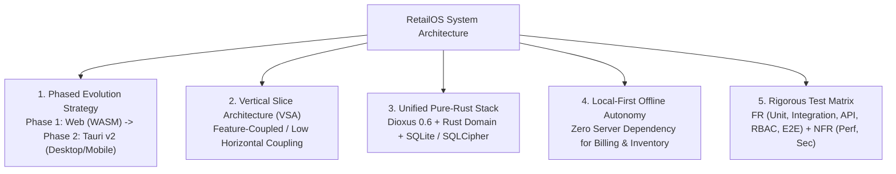
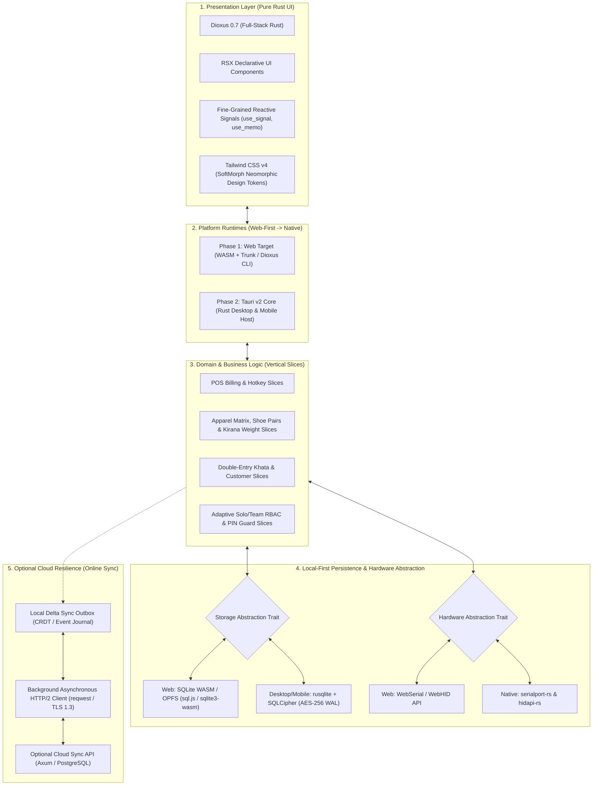
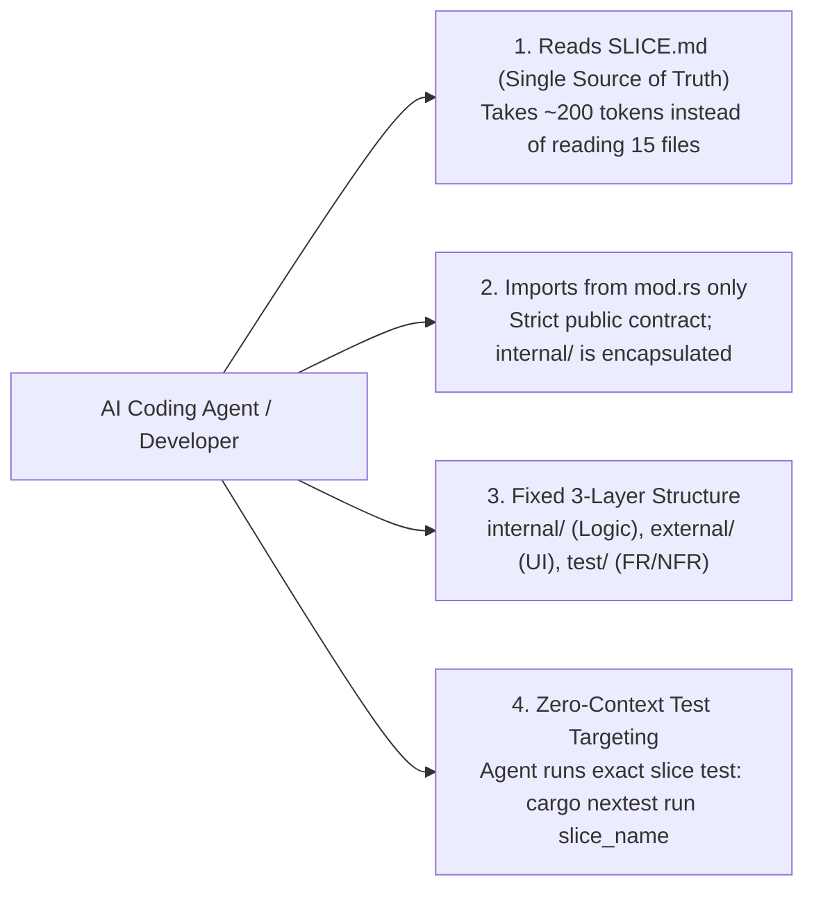
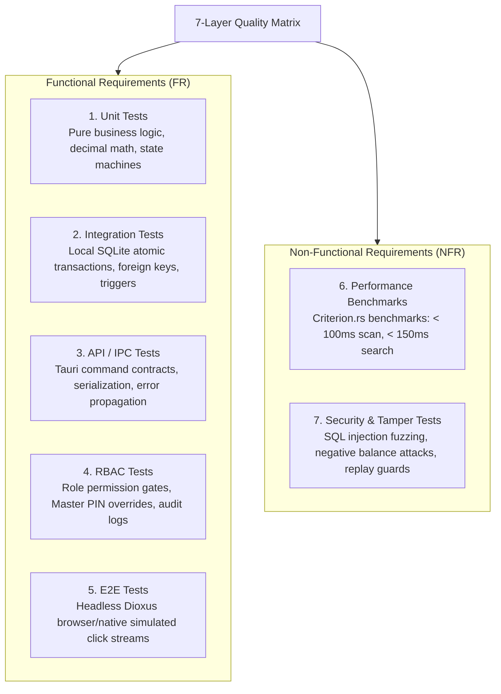
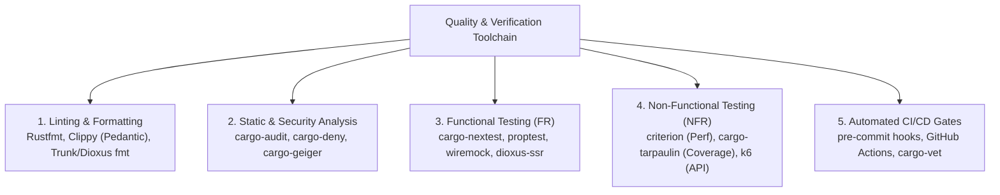
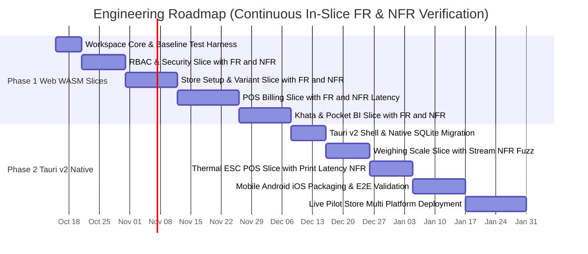
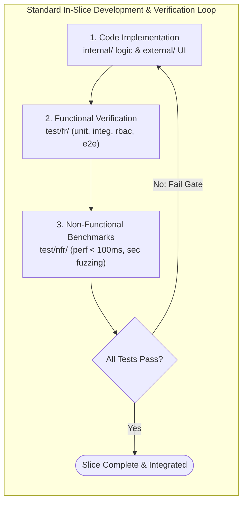

# System Architecture & Technical Specification
## Multi-Platform Local-First Retail ERP & Store Management System
### Vertical Slice Architecture (VSA), Pure Rust Stack (Dioxus Web $\rightarrow$ Tauri v2), & Comprehensive Quality Engineering

---

## Document Control & Governance

- **Document Identifier:** ARCH-RET-2026-V1.0
- **Document Title:** System Architecture & Technical Implementation Blueprint
- **Version:** 1.0
- **Author:** Principal System Architect & Lead Distributed Systems Engineer
- **Derived From:**
  - Capabilities & WBS Mapping (`docs/capabilities-development-mapping.md`)
  - Business Requirements Document (`docs/brd-retail-store-erp.md`)
  - BPMN Workflows (`docs/bpmn-retail-store-erp.md`)
  - UI/UX SoftMorph Design System (`docs/ui-ux-design-system.md`)
- **Core Strategy:** **Web-First (Dioxus WebAssembly + OPFS/IndexedDB SQLite) $\rightarrow$ Desktop & Mobile (Tauri v2 + Native Rust OS Drivers)**
- **Mermaid Compatibility:** Verified for Mermaid v11.16.0+

---

## 1. Executive Architectural Overview & Strategy



### 1.1 Strategy: Web-First $\rightarrow$ Tauri v2 Cross-Platform Target
To minimize duplicate code, maximize time-to-market, and validate features rapidly without cumbersome native installer packaging:
1. **Milestone 1 (Web-First Validation):**
   - The entire frontend UI (SoftMorph Design System) and domain engine are developed in **Dioxus (Full-Stack Rust)** compiling to **WebAssembly (WASM)**.
   - Local persistence on Web uses **SQLite compiled to WASM via OPFS (Origin Private File System)** or IndexedDB fallback.
   - Web allows 1-click cloud demonstrations, instant QA preview links, and zero-install client evaluation.
2. **Milestone 2 (Tauri v2 Packaging):**
   - The exact same Dioxus UI slices and Rust domain libraries are bundled into **Tauri v2**.
   - Swaps the Web storage adapter with **native `rusqlite` / `SQLCipher`** (sub-millisecond WAL mode).
   - Enables native OS hardware communication (**RS-232 serial weighing scales**, **USB/Bluetooth ESC/POS thermal printers**, **raw HID barcode scanners**).
   - Produces native binaries: Windows (`.msi`/`.exe`), macOS (`.dmg`), Linux (`.deb`/`AppImage`), Android (`.apk`), and iOS (`.ipa`).

### 1.2 Architectural Paradigm: Vertical Slice Architecture (VSA)
Rather than traditional layered architecture (controllers $\rightarrow$ services $\rightarrow$ repositories $\rightarrow$ entities) where a single change cuts across 5 directories, this system uses **Vertical Slice Architecture**:
- Each business feature (e.g., `quick_add_item`, `cash_checkout`, `khata_settlement`, `rbac_guard`) is self-contained.
- Every slice contains its own UI components, business logic, persistence contracts, external integrations, and dedicated FR/NFR test suites.
- Shared domain models and shared infrastructure are isolated into core foundations, preventing tight coupling across disparate retail verticals.

---

## 2. Complete End-to-End Technology Stack



### Detailed Tech Stack Specifications & Verified Stable Crate Versions (2026/Current)

| Architectural Layer | Web Milestone (Phase 1) | Tauri v2 Target (Phase 2) | Latest Production Crate / Tool Version | Rationale & Selection Criteria |
|:---|:---|:---|:---:|:---|
| **UI Framework** | Dioxus Web (Rust $\rightarrow$ WASM) | Dioxus Desktop / Mobile | `dioxus = "0.7"`<br>`dioxus-core = "0.7"` | Direct crate import; sub-second hot-patching without state loss; unified reactive signals across web & native. |
| **Desktop/Mobile Host** | Browser runtime (Trunk / dx build) | Tauri v2 Core Native Host | `tauri = "2.12"`<br>`tauri-build = "2.12"` | Multiplatform production release; mobile Android/iOS targets; fine-grained IPC capabilities. |
| **Styling & Neomorphism** | Tailwind CSS v4 Engine | Tailwind CSS v4 + Native OS Compositor | `tailwindcss = "^4.0"`<br>(via `@tailwindcss/cli` or PostCSS) | Modern CSS engine; no heavy JS runtime; zero-runtime SoftMorph clay/terracotta tokens. |
| **State Management** | Dioxus Signals (`use_signal`, `GlobalSignal`) | Dioxus Signals + Thread-safe channels | Built-in to `dioxus = "0.7"` | Zero boilerplate reactive state; eliminates Redux/Vuex overhead; sub-5ms UI component renders. |
| **Local Database Engine** | SQLite via WASM (OPFS / IndexedDB) | `rusqlite` + `SQLCipher` (Native C bindings) | `rusqlite = "0.40.2"` | True local-first data sovereignty; sub-10ms transactional writes in WAL mode; 100% offline autonomy. |
| **Decimal Currency & Math** | Pure Decimal Math | Pure Decimal Math | `rust_decimal = "1.43"`<br>`rust_decimal_macros = "1.43"` | Infallible money & loose Kirana fractional calculations without binary floating-point roundoff errors. |
| **Hardware IO (Scales)** | WebSerial / WebHID (Chrome / Edge) | `serialport-rs` (RS-232 COM port) | `serialport = "4.10.1"` | Low-level continuous stream reading for Essae/Phoenix weighing scales with zero external drivers. |
| **Hardware IO (Scanners)** | WebHID / Keyboard Input Interceptor | `hidapi` (USB HID Raw Input) | `hidapi = "2.6"` | Direct non-blocking capture of 1D/2D barcode scanners, bypassing OS keyboard delay. |
| **Receipt Printing** | Web Print API / Raw Socket Proxy | Direct TCP / USB Raw Socket (ESC/POS) | `escpos = "0.13"` | Instant ESC/POS raster formatting and dispatch to 58mm/80mm thermal receipt printers ($< 1\text{s}$). |
| **Security & Cryptography** | Argon2id + In-Memory Token Session | Argon2id + OS Secure Keystore/Keychain | `argon2 = "0.6.0"` | RFC 9106 password & Master PIN hashing with memory-hard resistance against GPU brute-force attacks. |
| **Networking & Async I/O** | `gloo-net` / Fetch API | `reqwest` (HTTP/2 + TLS 1.3 async) | `reqwest = "0.12"`<br>`tokio = "1.43"` | Non-blocking delta sync outbox transmission and WebSocket push updates when network is active. |

---

### 2.2 Standardized Workspace `Cargo.toml` Dependencies

```toml
[workspace]
resolver = "2"
members = [
    "src",
    "src-tauri",
    "packages/core-database",
    "packages/core-hardware",
    "packages/core-security",
    "packages/core-ui"
]

[workspace.dependencies]
# UI & Platform Core
dioxus = { version = "0.7", features = ["router"] }
tauri = { version = "2.12", features = [] }

# Async & Serialization
tokio = { version = "1.43", features = ["full"] }
serde = { version = "1.0", features = ["derive"] }
serde_json = "1.0"

# Financial Math & SQLite Persistence
rust_decimal = { version = "1.43", features = ["serde-float", "math-ops"] }
rust_decimal_macros = "1.43"
rusqlite = { version = "0.40.2", features = ["bundled", "bundled-sqlcipher", "chrono"] }

# Hardware Drivers
serialport = "4.10.1"
hidapi = "2.6"

# Security & Cryptography
argon2 = "0.6.0"
rand = "0.9"

# Networking & Sync
reqwest = { version = "0.12", features = ["json"] }

# Testing & Quality Engineering
proptest = "1.6"
criterion = { version = "0.5", features = ["html_reports"] }
```

---

## 3. Vertical Slice Architecture (VSA) Folder Mapping

The codebase is organized into **vertical slices** where each slice is self-contained. Every feature directory contains:
- `\internal`: Private business rules, domain entities, calculations, and local data persistence models.
- `\external`: Public Dioxus UI components, Dioxus signals, and exported command traits.
- `\test`: Comprehensive test suite divided into Functional Requirements (`\fr`) and Non-Functional Requirements (`\nfr`).

### 3.1 Root Project Tree
```
store/
├── Cargo.toml                          # Workspace root manifest
├── Dioxus.toml                         # Dioxus build configuration (Web & Desktop)
├── Makefile / taskfile.yml             # Unified build, test, and lint tasks
├── docs/                               # Architectural & product specifications
│   ├── rfp-retail-store-erp.md
│   ├── brd-retail-store-erp.md
│   ├── bpmn-retail-store-erp.md
│   ├── capabilities-development-mapping.md
│   ├── ui-ux-design-system.md
│   └── architecture.md
├── src-tauri/                          # Tauri v2 native desktop & mobile host (Phase 2)
│   ├── Cargo.toml
│   ├── tauri.conf.json
│   ├── capabilities/                   # Tauri v2 security capabilities
│   └── src/
│       ├── main.rs
│       └── lib.rs                      # Tauri command registration & plugin lifecycle
├── packages/                           # Shared foundational infrastructure
│   ├── core-database/                  # SQLite abstraction trait, migrations, SQLCipher
│   ├── core-hardware/                  # ESC/POS builder, RS-232 scale, barcode scanner traits
│   ├── core-security/                  # Cryptography, Argon2id, token hashing, audit logger
│   └── core-ui/                        # SoftMorph design tokens, SoftTile, icons, buttons
└── src/                                # Main application (Dioxus Web & Tauri UI)
    ├── main.rs                         # Application entrypoint
    ├── app.rs                          # Root layout, theme router, global context
    └── features/                       # VERTICAL SLICE ARCHITECTURE (By Capability)
        ├── onboarding_store_type/      # MOD-01: Store Profile & Dynamic Inventory
        ├── inventory_variant_matrix/   # MOD-01: Apparel/Footwear Matrix & Loose Kirana
        ├── stock_intake/               # MOD-01: Fast Intake, Camera Scan & Label Print
        ├── pos_checkout/               # MOD-02: Fast POS Billing & Hotkeys
        ├── pos_cart_parking/           # MOD-02: Cart Hold / Park & Resume
        ├── pos_hardware_hub/           # MOD-02: Scale Weight & Receipt Printer Drivers
        ├── payment_upi_cash/           # MOD-02: Dynamic UPI QR & Multi-Tenders
        ├── pocket_bi_analytics/        # MOD-03: Real-Time Net Profit & Dead Stock Radar
        ├── khata_ledger/               # MOD-03: Customer Digital Credit & WhatsApp Links
        ├── supplier_payables/          # MOD-03: Vendor Aging & FMCG Near-Expiry Alerts
        ├── rbac_security/              # MOD-04: Solo vs. Team Mode & Anti-Theft Guard
        └── shift_reconciliation/       # MOD-04: Blind Cash Count & Till Audit
```

---

## 4. Feature Slice Architecture & AI-Agent Token Optimization

### 4.1 Token Efficiency & Cognitive Optimization for AI Coding Agents
When AI coding agents (or human developers) interact with a large codebase, redundant context consumption causes high latency, token truncation, and hallucinated imports. To make this architecture **100% token-efficient and instantly parsed by AI agents**, each vertical slice follows strict structural conventions:



#### Why This Design is Optimal for AI Coding Agents:
1. **Zero-Guesswork File Layout:** An AI agent always knows the exact file to read or edit without globbing or searching the entire workspace:
   - Data & Calculations $\rightarrow$ `internal/logic.rs` & `internal/repo.rs`
   - UI & Dioxus Views $\rightarrow$ `external/view.rs` & `external/components.rs`
   - Test Verifications $\rightarrow$ `test/fr/` & `test/nfr/`
2. **The `SLICE.md` Manifest Pattern:** Each slice contains a standardized `< 30-line` markdown card defining its capabilities, exported symbols, database tables touched, and RBAC rules. An agent only needs to read `SLICE.md` (~250 tokens) to understand the entire feature before writing code.
3. **Strict Invariant Boundary (`mod.rs`):** The public interface is strictly defined in `mod.rs`. Anything in `internal/` is hidden from the rest of the app, preventing circular imports and out-of-scope LLM edits.

---

### 4.2 Standardized Slice Tree Template & CSS Separation Strategy

#### Why a Dedicated `style.css` in `external/` is Best Practice for Token Efficiency:
1. **Isolated Styling Context:** When tweaking colors, shadows, or neomorphic soft margins, an AI agent (or designer) only opens `style.css` (~50–100 tokens), **without reading or risking 500+ lines of Rust UI logic and event handlers** in `components.rs` or `views.rs`.
2. **Zero Inadvertent Logic Breakage:** Keeping CSS separate guarantees that an LLM working on visual design cannot accidentally delete Rust signals, event handlers, or calculation bindings.
3. **Tailwind CSS v4 `@theme` & Component Scoping:** Modern Tailwind v4 allows slice-specific styles to be colocated via `@theme` or `@utility` without polluting global sheets.

Every feature slice in `src/features/<slice_name>/` adheres to the standardized canonical topology:

```
src/features/<slice_name>/
├── SLICE.md              # [AI Manifest] Capabilities, dependencies, schema, and RBAC rules
├── mod.rs                # [Public Interface] Re-exports only external components & hooks
│
├── internal/             # [Encapsulated Domain & Persistence] (No external imports allowed)
│   ├── logic.rs          # Pure business math, state transitions, validation rules
│   ├── models.rs         # Domain entities, value objects, typed errors (Result<T, Error>)
│   └── repo.rs           # SQLite queries & atomic transactions (rusqlite / OPFS)
│
├── external/             # [Presentation & Public Bindings]
│   ├── style.css         # [Slice Styling] Scoped Tailwind utilities, Neomorphic soft shadows
│   ├── components.rs     # Dioxus RSX UI elements (imports style.css, pure markup)
│   ├── hooks.rs          # Reactive Dioxus signals (use_signal) & event listeners
│   └── views.rs          # Responsive screen layouts (Desktop 3-Pane / Mobile Drawer)
│
└── test/                 # [Quality Verification Matrix]
    ├── fr/               # Functional Requirements
    │   ├── unit.rs       # Pure math & logic tests (sub-millisecond, zero I/O)
    │   ├── integ.rs      # SQLite transactional persistence & trigger verification
    │   ├── rbac.rs       # Role boundary checks & Master PIN prompt assertions
    │   └── e2e.rs        # User interaction workflow simulation
    └── nfr/              # Non-Functional Requirements
        ├── perf.rs       # Latency (<100ms scan) & throughput criterion benchmarks
        └── sec.rs        # Input sanitization, tamper resistance & negative-value checks
```

---

### 4.3 Standardized `SLICE.md` Template (AI-Agent Context Contract)

Every feature slice includes this concise manifest at its root. When assigning an agent a coding task, providing this manifest gives complete context in under 300 tokens:

```markdown
# SLICE: pos_checkout

## 1. Metadata & Capability Traceability
- **Capability ID:** MOD-02 / FEAT-201 (`SF-201.1`, `SF-201.2`)
- **BRD / BPMN Mapping:** `BR-POS-01`, `BR-POS-06` | `BPMN-2`
- **Operating Modes:** Solo Mode (Frictionless) | Team Mode (Cashier Guarded)

## 2. Exports (`mod.rs`)
- `CheckoutView`: Main desktop/mobile POS billing layout.
- `use_cart_session()`: Global reactive cart signal & hotkey handler.
- `execute_sale_commit()`: Local transactional sale finalization.

## 3. Storage & Schema Touched
- Reads: `inventory`, `products`, `customers`, `store_settings`
- Writes: `sales` (insert), `sale_items` (insert), `inventory` (decrement qty)

## 4. RBAC & Security Gates
- Cashier: Allowed to scan, bill, tender cash/UPI. Cannot void or delete without PIN.
- Owner / PIN: Required for price overrides, manual discounts > $5, and cart voids.

## 5. Test Suite Verification
- `cargo nextest run features::pos_checkout::test::fr`
- `cargo bench --bench pos_checkout_perf`
```

---

## 5. Architectural Quality Attributes & Test Strategy

Every feature slice must pass the standardized **7-Layer Quality Matrix**:



### 5.1 Test Layer Execution Criteria
| Test Layer | Target Directory | Framework / Tool | Success Threshold & Pass Criteria |
|:---|:---|:---|:---|
| **FR: Unit** | `test/fr/unit/` | Standard Rust `#[test]` | $100\%$ determinism; execute in $< 5\text{ms}$; zero network/database I/O. |
| **FR: Integration**| `test/fr/integration/` | `rusqlite` in-memory / WASM mock | Atomic ACID guarantee; rollbacks on failure; foreign key integrity validated. |
| **FR: API / IPC** | `test/fr/api/` | Tauri test harness / Axum test | Serde JSON serialization validated; strict error code matching. |
| **FR: RBAC** | `test/fr/rbac/` | Custom `SecurityContext` fixture | Cashier blocked from margins/voids; Owner PIN prompts intercept actions; audit trails created. |
| **FR: E2E** | `test/fr/e2e/` | `dioxus-ssr` / Playwright WASM | Full checkout completed from simulated user interactions without errors. |
| **NFR: Perf** | `test/nfr/performance/`| `criterion` benchmarking crate | Scan-to-cart latency $< 100\text{ms}$; 50,000 SKU search $< 150\text{ms}$; memory consumption $< 120\text{MB}$. |
| **NFR: Security** | `test/nfr/security/` | `proptest` / property-based fuzzing | Negative price/qty rejected; price manipulation blocked; SQL injection payload sanitization. |

---

## 6. Detailed Capabilities to Vertical Slice Mapping

The 5 business modules and 15 capabilities from `docs/capabilities-development-mapping.md` map into concrete vertical slices:

| Module | Sub-Features Covered | Slice Directory Name | Core Deliverables (Internal / External / Test) |
|:---|:---|:---|:---|
| **MOD-01** | `SF-101.1`, `SF-101.2`, `SF-101.3` | `src/features/onboarding_store_type/` | • `internal/`: Store archetype catalog seeder (Clothes, Shoes, Kirana, Custom).<br>• `external/`: 3-minute setup wizard modal with SoftMorph cards.<br>• `test/`: Validates dynamic schema toggling, pre-seeded FMCG barcodes. |
| **MOD-01** | `SF-102.1`, `SF-102.2`, `SF-102.3` | `src/features/inventory_variant_matrix/`| • `internal/`: 2D Matrix SKU generator (Size/Color), footwear size charts, Kirana bulk-to-decimal math.<br>• `external/`: Variant matrix picker, loose weight fraction selector.<br>• `test/`: Decimal unit deduction math, left/right shoe pair integrity. |
| **MOD-01** | `SF-103.1`, `SF-103.2`, `SF-103.3` | `src/features/stock_intake/` | • `internal/`: TSPL / ESC/POS label raster builder (50x25mm garment/shoe tags).<br>• `external/`: Fast in-billing quick add modal ($< 10$s), mobile camera intake view.<br>• `test/`: In-billing item creation speed benchmark, label raster verification. |
| **MOD-02** | `SF-201.1`, `SF-201.2`, `SF-201.3` | `src/features/pos_checkout/` & `pos_cart_parking/` | • `internal/`: Local cart session, hotkey dispatcher (`F1`-`F12`), cart parking repo.<br>• `external/`: Desktop multi-column split view, mobile slide-up drawer, emergency lock.<br>• `test/`: Cart hold/resume state machine, sub-100ms scan benchmark. |
| **MOD-02** | `SF-202.1`, `SF-202.2`, `SF-202.3` | `src/features/pos_hardware_hub/` | • `internal/`: SerialPort RS-232 parser (Essae/Phoenix), USB HID raw scanner listener, ESC/POS socket.<br>• `external/`: Live scale weight indicator tray, printer status pill.<br>• `test/`: Scale continuous stream parser fuzzing, mock ESC/POS buffer checks. |
| **MOD-02** | `SF-203.1`, `SF-203.2`, `SF-203.3` | `src/features/payment_upi_cash/` | • `internal/`: NPCI UPI payload formatter, multi-tender split math, WhatsApp receipt link generator.<br>• `external/`: Terracotta cash tender calculator, dynamic on-screen UPI QR dialog.<br>• `test/`: Split tender balance reconciliation, payment QR payload validation. |
| **MOD-03** | `SF-301.1`, `SF-301.2`, `SF-301.3` | `src/features/pocket_bi_analytics/` | • `internal/`: Real-time net margin calculator (Sales - COGS - Overheads), dead stock SQL index.<br>• `external/`: Pocket mobile dashboard cards, dead stock markdown clearance buttons.<br>• `test/`: True net profit formula verification, 90-day dead stock query benchmark. |
| **MOD-03** | `SF-302.1`, `SF-302.2`, `SF-302.3` | `src/features/khata_ledger/` | • `internal/`: Double-entry customer credit ledger, credit limit validator, WhatsApp reminder builder.<br>• `external/`: Customer Khata balance list, WhatsApp reminder dispatch drawer.<br>• `test/`: Khata balance debit/credit integrity, credit limit boundary attacks. |
| **MOD-03** | `SF-303.1`, `SF-303.2`, `SF-303.3` | `src/features/supplier_payables/` | • `internal/`: Distributor payment aging engine, FMCG near-expiry chronoworker, tax CSV generator.<br>• `external/`: Payables due calendar, near-expiry radar table, 1-click tax export.<br>• `test/`: Expiry date calculation fuzzing, tax summary aggregation checks. |
| **MOD-04** | `SF-401.1`, `SF-401.2`, `SF-402.1` | `src/features/rbac_security/` | • `internal/`: Security context provider, Owner PIN authorizer, append-only SQLite audit log writer.<br>• `external/`: Solo mode toggle switch, restricted cashier UI views, Master PIN dialog.<br>• `test/`: Strict RBAC permission matrix checks, anti-theft override verification. |
| **MOD-04** | `SF-402.2`, `SF-403.1`, `SF-403.2` | `src/features/shift_reconciliation/` | • `internal/`: Blind cash count discrepancy calculator, staff attendance ledger, commission engine.<br>• `external/`: Shift handover blind denomination sheet, attendance stamp button.<br>• `test/`: Blind count shortage detection, salesperson attribution logic. |

---

## 7. Linting, Static Analysis & Comprehensive Testing Toolchain

To ensure enterprise-grade code health, strict memory safety, zero regressions, and robust compliance across both Web and native Tauri runtimes, the project enforces a standardized toolchain for static analysis, functional verification (FR), and non-functional verification (NFR).



### 7.1 Linting, Formatting & Code Style Enforcement
| Category | Tool / Utility | Scope & Configuration | Enforced Rules & Strictness |
|:---|:---|:---|:---|
| **Code Formatting** | `rustfmt` | Rust workspace & Dioxus components | • Edition 2021<br>• `max_width = 100`<br>• `use_small_heuristics = "Max"`<br>• `reorder_imports = true` |
| **Dioxus RSX Linting**| `dioxus fmt` / Dioxus CLI | RSX macro syntax | Enforces clean declarative markup formatting for Dioxus components. |
| **Compiler Linter** | `clippy` | Deep semantic code analysis | Enforces `-D warnings` and pedantic rules:<br>• `clippy::all`<br>• `clippy::pedantic`<br>• `clippy::nursery`<br>• `clippy::unwrap_used` (disallowed in domain/internal slices)<br>• `clippy::arithmetic_side_effects` (prevents integer overflows in money/stock math) |
| **Dependency Auditing**| `cargo-deny` | Workspace dependency tree | • Blocks GPL / non-compliant licenses.<br>• Detects duplicate dependency versions.<br>• Validates advisory databases. |
| **Unsafe Code Audit** | `cargo-geiger` | Unsafe memory usage scanner | Verifies that all domain slices and business logic maintain $0\%$ unsafe Rust. |
| **Vulnerability Audit**| `cargo-audit` | RUSTSEC security advisories | Fails CI pipeline if any dependency has known CVE vulnerabilities. |

### 7.2 Functional Requirements (FR) Testing Toolchain
The functional verification harness is integrated directly into the `test/fr/` directory of each vertical slice:

```
test/fr/
├── unit/         # Pure domain logic verification
├── integration/  # SQLite transactional persistence & local triggers
├── api/          # Tauri IPC command / local bus serialization
├── rbac/         # Role permissions, PIN interception & audit log tests
└── e2e/          # Simulated end-to-end user checkout flows
```

| FR Test Category | Target Directory | Primary Testing Tool | Scope & Objectives |
|:---|:---|:---|:---|
| **FR: Unit Tests** | `test/fr/unit/` | `cargo-nextest` + Rust standard test harness | Sub-millisecond execution; pure calculations (tax, decimal Kirana math, footwear pair matching, currency rounding). Zero I/O or database dependencies. |
| **FR: Property-Based**| `test/fr/unit/` | `proptest` / `quickcheck` | Fuzzes boundary conditions (e.g., negative prices, $0.0001\text{kg}$ weight fractions, massive discount thresholds) to prove mathematical infallibility. |
| **FR: Integration** | `test/fr/integration/` | `rusqlite` (in-memory) + `testcontainers` (sync cloud) | Verifies atomic ACID guarantees: ensuring that completing a bill updates sales ledger and decrements inventory in a single atomic transaction. |
| **FR: API & IPC** | `test/fr/api/` | Tauri test harness (`tauri::test`) | Verifies command IPC serializations, payload deserializations, and typed error responses (`Result<T, AppError>`). |
| **FR: RBAC Gates** | `test/fr/rbac/` | Custom `SecurityContext` test mock | Rigorously asserts role boundary restrictions: Cashier is blocked from profit views; discounts $> \$X$ require Master PIN; audit logs are created. |
| **FR: E2E Flows** | `test/fr/e2e/` | `dioxus-ssr` + Playwright (for Web WASM) | Headless browser and virtual DOM testing simulating user journeys: scan barcode $\rightarrow$ auto-read scale $\rightarrow$ cash tender $\rightarrow$ receipt print. |

### 7.3 Non-Functional Requirements (NFR) Testing Toolchain
Non-functional attributes (Performance, Reliability, Security) are rigorously validated in `test/nfr/`:

```
test/nfr/
├── performance/  # Latency, throughput, and memory benchmarks
└── security/     # Fuzzing, SQL injection, and data tamper guards
```

| NFR Test Category | Target Directory | Primary Testing Tool | SLA Targets & Verification Criteria |
|:---|:---|:---|:---|
| **NFR: Latency & Benchmarks** | `test/nfr/performance/` | `criterion.rs` | Benchmarks critical paths with nanosecond precision:<br>• Barcode scan-to-cart latency: $< 100\text{ms}$ ($p99$)<br>• Search across 50,000 SKUs: $< 150\text{ms}$<br>• Local SQLite write commit: $< 10\text{ms}$ |
| **NFR: Memory Footprint** | `test/nfr/performance/` | `dhat` / Valgrind / Heaptrack | Confirms zero memory leaks in continuous POS loops; client heap memory consumption must remain $< 120\text{MB}$. |
| **NFR: Code Coverage** | Workspace-wide | `cargo-tarpaulin` / `llvm-cov` | Enforces minimum code coverage thresholds:<br>• Domain & Math: $\ge 90\%$<br>• RBAC & Security: $\ge 95\%$<br>• Overall Slice Coverage: $\ge 80\%$ |
| **NFR: Security & Fuzzing** | `test/nfr/security/` | `cargo-fuzz` (libFuzzer) | Fuzzes input fields (barcode scanner buffers, serial port streams, customer phone numbers) against buffer overruns and crashes. |
| **NFR: Tamper Resistance** | `test/nfr/security/` | Custom tamper test suite | Verifies that manual price overrides, negative stock deductions, and ledger tampering are rejected by database triggers and domain validation. |

### 7.4 Automated CI/CD Quality Gates & Makefile Tasks

A unified command suite is configured to execute all linting, formatting, and test suites with a single terminal command:

```bash
# 1. Format check
cargo fmt --all -- --check
dx fmt --check

# 2. Strict Clippy lint check
cargo clippy --all-targets --all-features -- -D warnings

# 3. Security & Dependency audits
cargo audit
cargo deny check

# 4. Rapid parallel testing with cargo-nextest
cargo nextest run --all-features

# 5. Non-functional performance benchmarks
cargo bench

# 6. Code coverage reporting
cargo tarpaulin --out Xml --output-dir ./coverage --fail-under 80
```

---

## 8. Development Roadmap & Continuous In-Slice Verification Plan

> **Core Quality Principle: In-Slice Continuous Verification (Zero Deferred Testing)**  
> In Vertical Slice Architecture, a slice is **never considered "done"** until its internal logic, presentation, functional tests (`test/fr/`), and non-functional benchmarks (`test/nfr/`) all pass. Testing is an integrated atomic part of building each slice—**never deferred to the end of a phase**.



### 8.1 In-Slice Definition of Done (DoD)
Before any pull request or task for a vertical slice (`src/features/<slice_name>/`) can be merged, it must satisfy the complete slice lifecycle:



Every feature slice must pass this 5-point verification checklist on every commit:
1. **`internal/` & `external/` Implementation:** Private domain calculations and public Dioxus UI components built to design system spec.
2. **FR Unit & Property Tests (`test/fr/unit.rs`):** $100\%$ pass on pure business calculations and boundary conditions via `cargo nextest`.
3. **FR Integration & RBAC Tests (`test/fr/integ.rs`, `rbac.rs`):** Atomic SQLite transaction commits verified; role boundary restrictions and Master PIN prompt assertions pass.
4. **NFR Performance Benchmarks (`test/nfr/perf.rs`):** Criterion.rs benchmark proves execution meets latency SLAs ($< 100\text{ms}$ scan-to-cart, $< 150\text{ms}$ search).
5. **NFR Security Tests (`test/nfr/sec.rs`):** Property-based fuzzing confirms zero buffer overflows and rejection of negative-value or SQL tampering attempts.

---

### 8.2 Phase Summary:
1. **Phase 1: Web First with Continuous Slice Testing (Weeks 1–7):**
   - Pure Dioxus Web development compiled to WebAssembly with OPFS/IndexedDB SQLite.
   - Slices delivered sequentially (`rbac_security` $\rightarrow$ `inventory_variant_matrix` $\rightarrow$ `pos_checkout` $\rightarrow$ `khata_ledger` $\rightarrow$ `pocket_bi_analytics`).
   - Each slice ships fully tested with its own `test/fr/` and `test/nfr/` suites before moving to the next feature.
2. **Phase 2: Tauri v2 Cross-Platform & Native Hardware Slices (Weeks 8–13):**
   - Wraps tested Dioxus slices into Tauri v2 desktop and mobile shells.
   - Integrates hardware slices (`pos_hardware_hub`, `serialport-rs`, `escpos`), each verified with continuous stream fuzzing and latency benchmarks.
   - Compiles native executables for Windows, macOS, Linux, Android, and iOS, followed by live multi-store pilot rollouts.
