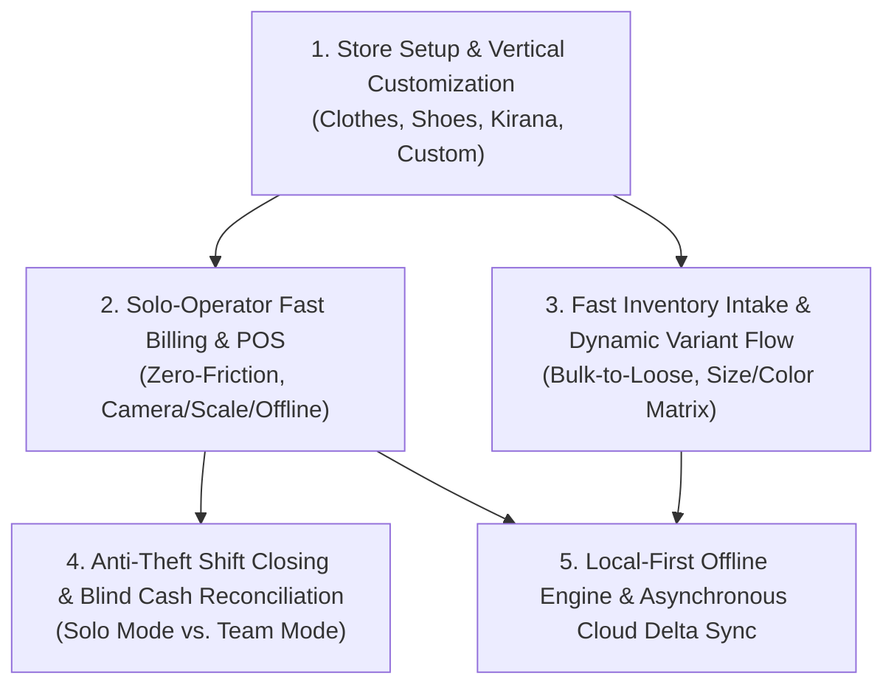
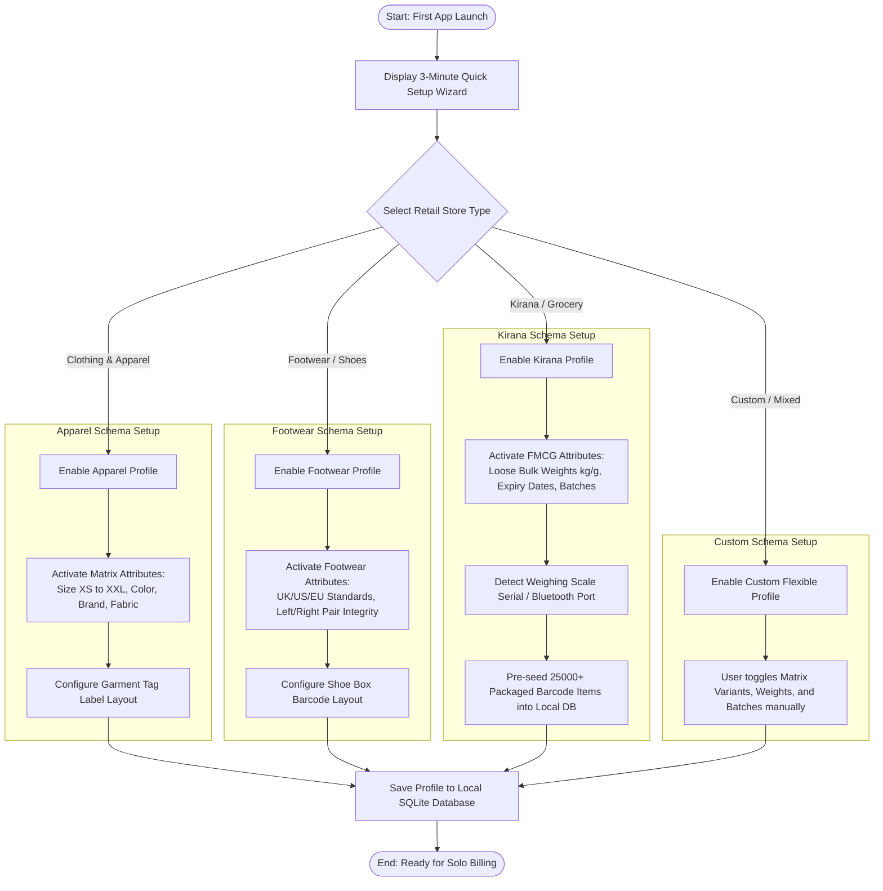
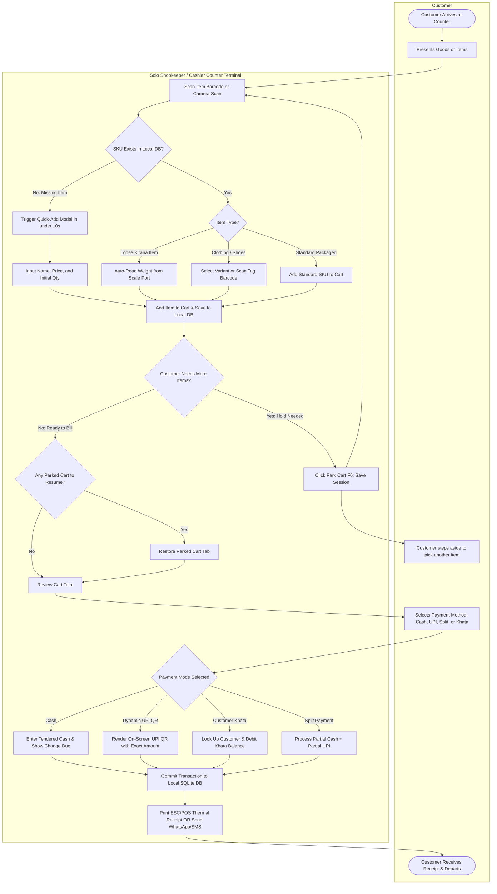
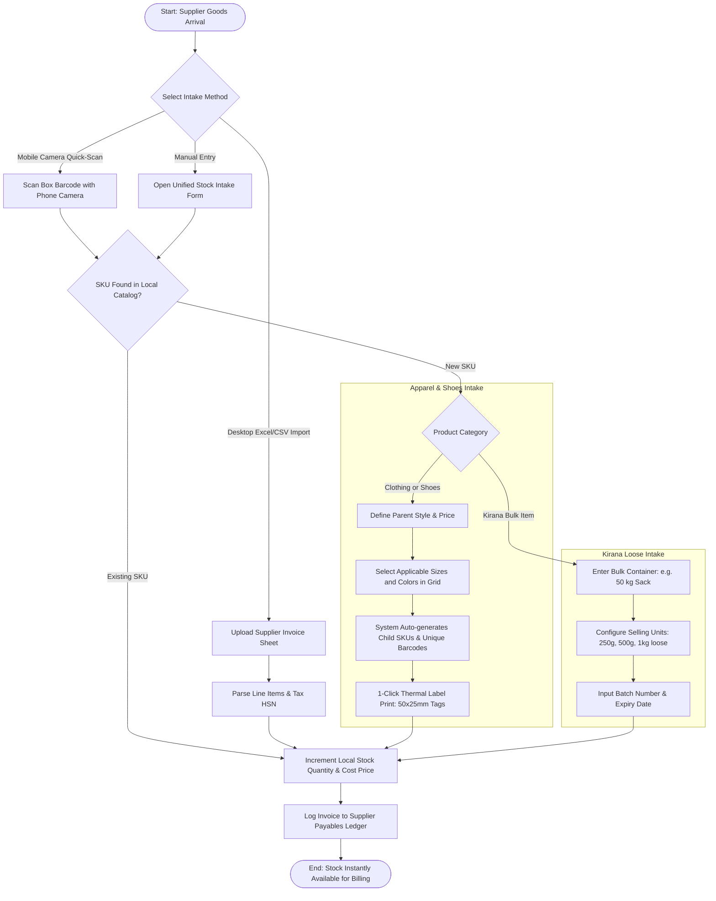
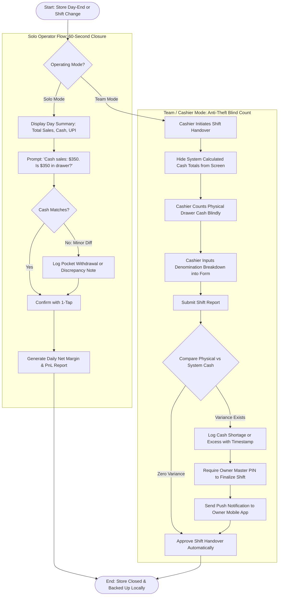
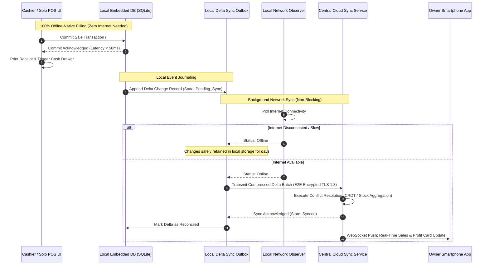
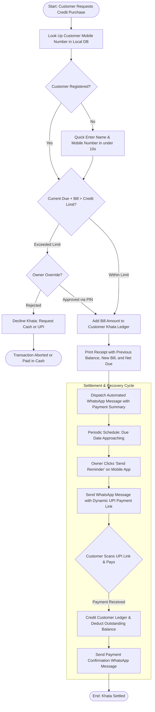

# BPMN Business Process Flow Diagrams
## Local-First Retail Store Management & ERP System
### Derived from BRD (`docs/brd-retail-store-erp.md`) & RFP (`docs/rfp-retail-store-erp.md`)

---

## Document Control & Overview

- **Document Identifier:** BPMN-RET-2026-V1.0
- **Document Title:** Business Process Model and Notation (BPMN) Architecture & Operational Workflows
- **Version:** 1.0
- **Target Audience:** Solution Architects, Frontend/Backend Developers, UX Designers, and QA Engineers
- **Mermaid Compatibility:** Verified for Mermaid v11.16.0+ (valid clean syntax, escaped labels, standard flowchart swimlane patterns)
- **Traceability:** Direct mapping to BRD Modules 1 through 4

---

## 1. Process Architecture Overview

The system processes are organized into five primary end-to-end BPMN workflows:

---

## 2. BPMN 1: Store Initialization & Vertical Schema Configuration
**BRD Reference:** `BR-INV-01`, `BR-INV-02`, `BR-INV-03`, `BR-INV-04`, `BR-INV-06`  
**Description:** Captures the zero-friction onboarding flow where the shopkeeper selects their business vertical, dynamically loading attributes, units of measure, and peripheral drivers into local SQLite storage.

---

## 3. BPMN 2: Unified Solo-Operator POS & Fast Billing Workflow
**BRD Reference:** `BR-POS-01` through `BR-POS-08`, `BR-INV-05`  
**Description:** Swimlane diagram illustrating how a single operator handles high-velocity checkouts, missing item intake on the fly, cart parking, digital weighing scales, and split multi-tender payments without leaving the billing screen.

---

## 4. BPMN 3: Fast Inventory Intake & Dynamic Variant Flow
**BRD Reference:** `BR-INV-01`, `BR-INV-02`, `BR-INV-03`, `BR-INV-04`, `BR-INV-07`  
**Description:** Business process showing how incoming supplier inventory is logged with minimum overhead, handling clothing size/color grids, footwear pairs, and kirana bulk packaging conversion.

---

## 5. BPMN 4: Shift Closing & Cash Reconciliation (Solo vs. Team Mode)
**BRD Reference:** `BR-EMP-01`, `BR-EMP-03`, `BR-EMP-04`, `BR-BI-01`  
**Description:** Demonstrates the anti-theft shift closure mechanism, contrasting the 60-second solo tally with the blind cash audit enforced on hired staff.

---

## 6. BPMN 5: Local-First Data Flow & Asynchronous Cloud Delta Sync
**BRD Reference:** `BR-POS-01`, `NFR-DATA-01`, `NFR-DATA-02`, `NFR-DATA-03`  
**Description:** Visualizes the offline-native execution engine, guaranteeing that transactions complete in sub-100ms locally without waiting for cloud connectivity, followed by resilient background synchronization.

---

## 7. BPMN 6: Customer Khata (Digital Credit) & Payment Recovery Workflow
**BRD Reference:** `BR-BI-04`, `BR-POS-04`, `BR-POS-05`  
**Description:** Process model showing customer credit extension at the counter and digital payment settlement via WhatsApp payment links.

---

## 8. Summary of Process Improvements & Traceability

| BPMN Workflow | Primary User Persona | Key Architectural Breakthrough | BRD Traceability |
|:---|:---|:---|:---|
| **1. Store Setup & Schema** | Shop Owner (Solo) | Dynamic UI reconfiguration; eliminates bloated irrelevant menus. | `BR-INV-01`, `BR-INV-02`, `BR-INV-03`, `BR-INV-04` |
| **2. Solo-Operator Fast Billing** | Cashier / Solo Owner | In-billing instant item creation ($< 10$s) and cart parking. | `BR-POS-01` through `BR-POS-08`, `BR-INV-05` |
| **3. Inventory Intake** | Owner / Stock Staff | Size/Color variant grid generation and Kirana bulk-to-loose math. | `BR-INV-01`, `BR-INV-04`, `BR-INV-07` |
| **4. Shift Reconciliation** | Owner vs. Cashier | Dual path: 60-second solo closure vs. anti-theft blind count for staff. | `BR-EMP-01`, `BR-EMP-03`, `BR-EMP-04` |
| **5. Local-First Delta Sync** | System Architecture | Sub-50ms offline commit; zero cloud dependencies for active billing. | `BR-POS-01`, `NFR-DATA-01`, `NFR-DATA-02` |
| **6. Khata Settlement** | Shop Owner & Customer | Direct WhatsApp reminder links with integrated UPI QR codes. | `BR-BI-04`, `BR-POS-04` |
