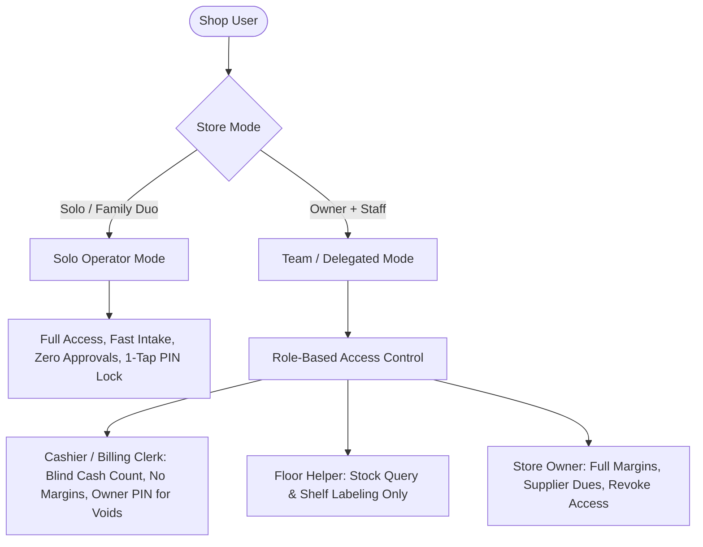
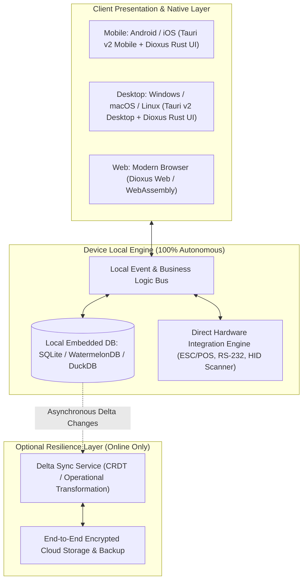
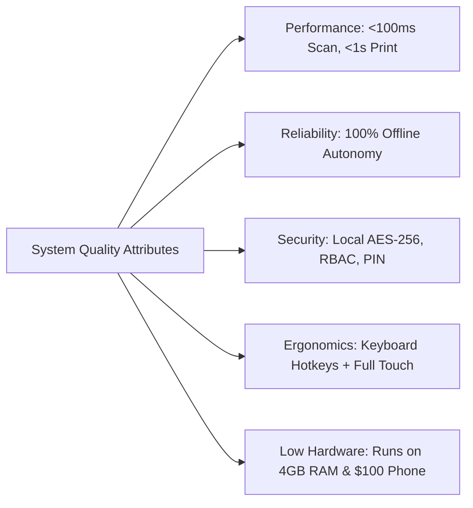
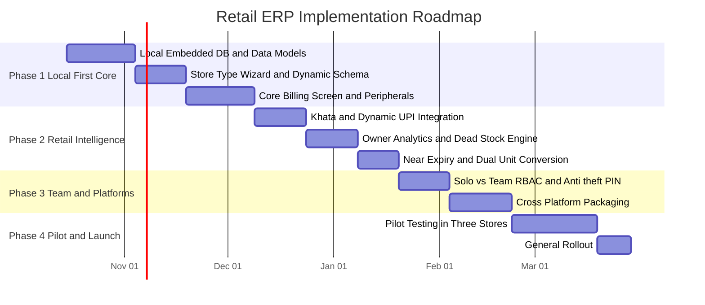

# Business Requirements Document (BRD)
## Multi-Platform Local-First Retail Management & ERP System
### Tailored for Solo & Small-Team Retailers (Clothing, Footwear, Kirana / Grocery, and Mixed Retail)

---

## Document Control & Governance

- **Document Identifier:** BRD-RET-2026-V1.0
- **Document Title:** Business Requirements Document – Local-First Retail Store Management Solution
- **Version:** 1.0 (Baseline)
- **Status:** Approved for Technical Architecture & Sprint Planning
- **Author:** Lead Retail Business Analyst & Principal Product Manager
- **Derived From:** RFP V3.0 (`docs/rfp-retail-store-erp.md`)
- **Target Audience:** Product Engineers, Solution Architects, UI/UX Designers, QA Leads, and Retail Stakeholders
- **Effective Date:** October 12, 2026

### Revision History
| Version | Date | Author | Description of Changes |
|:---|:---|:---|:---|
| **v1.0** | Oct 12, 2026 | Lead BA & PM | Initial baseline specification with End-to-End Traceability Matrix mapping RFP requirements to BRD capabilities, User Stories, and Acceptance Criteria. |

---

## 1. Executive Summary & Product Vision

### 1.1 Product Vision Statement
To build an **ultra-responsive, local-first retail operating system** that runs seamlessly across **Mobile (Android, iOS)**, **Desktop (Windows, macOS, Linux)**, and **Web**. It equips micro and small retail shopkeepers (1–2 operators in Clothing, Shoes, Kirana, or General Retail) with frictionless billing, automatic vertical-specific inventory management, crystal-clear business health analytics, and optional anti-theft employee controls—**completely autonomous without internet dependency**.

### 1.2 Core Problem Statement
1. **The Solo-Operator Dilemma:** Most retail software is built for corporate teams with separated departments (Purchasing, Warehousing, Cashier, Auditing). A single shopkeeper managing the entire store is overwhelmed by nested menus, multiple approval gates, and rigid data entry.
2. **Cloud Fragility:** Cloud-only SaaS apps stall or fail during broadband cuts or rural/semi-urban network fluctuations, stalling billing queues and losing sales.
3. **Vertical Mismatch:** Apparel and shoe stores struggle without Size/Color/Pair variant matrices; Kirana stores struggle without fractional loose weight (kg/grams) and near-expiry monitoring.
4. **Opaque Business Health:** Shopkeepers know their daily cash inflow but lack real-time visibility into net margin, trapped dead stock capital, supplier dues, and customer credit (*Khata*).

### 1.3 Strategic Business Goals & Success Metrics (OKRs)
| Objective | Success Metric / Key Result (KR) | Target |
|:---|:---|:---|
| **Checkout Speed** | Time required to scan and complete a standard 5-item cash/UPI checkout | **< 15 seconds** |
| **Operational Autonomy** | Local functionality when disconnected from the Internet | **100% feature availability** (Billing, Inventory, Khata, Reports) |
| **Onboarding Velocity** | Time taken by a non-technical shopkeeper to configure their store type and issue their first bill | **< 10 minutes** |
| **Inventory Precision** | Shrinkage and discrepancy detection during periodic shelf stocktakes | **< 1% variance** |
| **Dead Stock Liquidation** | Reduction in capital trapped in stagnant fashion/footwear stock over 90 days | **>= 25% reduction within 90 days** |

---

## 2. User Personas & Operational Modes



### 2.1 Persona Matrix
| Persona | Typical Profile | Primary Job to be Done (JTBD) | Pain Points Addressed |
|:---|:---|:---|:---|
| **Ramesh (Solo Shopkeeper)** | Owner & sole operator of a neighborhood Kirana / Cloth shop. | Multi-task billing, unpack boxes, check supplier bills, and close the shop fast. | Cannot waste time navigating back-office screens; needs instant item creation at checkout and loose weight handling. |
| **Priya (Footwear Store Owner)** | Runs a shoe boutique with 1–2 sales helpers. | Monitor daily profits, liquidate slow-moving shoe sizes, track staff sales incentives. | Stock trapped in awkward sizes; helpers giving unauthorized discounts; needs mobile pocket visibility. |
| **Sunil (Store Cashier / Helper)** | Hourly or salaried counter staff. | Scan items fast, collect cash/UPI, handle simple exchanges. | Needs simple hotkey billing; should not see owner profits or vendor costs; prevented from fraud. |

### 2.2 Operational Operating Modes
- **Mode 1: Solo Operator Mode (Default):** All staff, attendance, and multi-user overhead is hidden. Fast-lane workflows enabled (1-tap item quick-add, 1-tap cart parking, 60-second day-end till tally).
- **Mode 2: Team / Delegated Mode:** Activates automatically when the owner adds a secondary user. Enforces strict cashier permissions, blind cash counts, and Owner PIN authorization on sensitive actions.

---

## 3. Product Architecture & Technical Scope

### 3.1 Local-First Architecture Blueprint


### 3.2 Platform Compatibility Matrix
- **Mobile:** Android 9.0+ (ARM64/v7a), iOS/iPadOS 15.0+
- **Desktop:** Windows 10 & 11 (x64), macOS 12+ (Universal Intel & Apple Silicon), Linux (Ubuntu 20.04+, Debian 11+, Flatpak/AppImage)
- **Web:** Evergreen Chromium, Safari, Firefox (IndexedDB/WASM)

---

## 4. Comprehensive Business & Functional Requirements

### 4.1 Module 1: Store Configuration & Dynamic Inventory Personalization
#### Business Goal
Allow any small retailer to set up their specific business in minutes without vendor assistance or custom code.

| BRD Requirement ID | Feature Description | Solo vs. Team Behavior | Critical Business Rules & Logic | RFP Mapping |
|:---|:---|:---|:---|:---:|
| **BR-INV-01** | **User-Guided Store Type Initialization** | Identical in both modes. | During first launch, prompts user: `Clothing`, `Footwear`, `Kirana / Grocery`, or `Custom / Mixed`. Reconfigures UI attributes and units in real-time. | `FR-SET-01` |
| **BR-INV-02** | **Apparel Variant Matrix Engine** | Used by owner/cashier. | Generates matrix SKU from Parent + Size (XS-XXL) + Color + Fabric. Single-screen stock quantity distribution across variants. | `FR-SET-02`<br>`FR-INV-01` |
| **BR-INV-03** | **Footwear Box & Size Standards** | Used by owner/cashier. | Standardized UK/India, US, EU size mapping. Tracks left/right pair integrity. Barcode scanning identifies exact box in stock. | `FR-SET-02`<br>`FR-INV-01` |
| **BR-INV-04** | **Kirana Loose & Dual Unit Conversion** | Used by owner/cashier. | Supports parent bulk unit (e.g., 50kg bag) and child retail unit (kg, grams, liters). Selling 750g automatically deducts 0.75kg from bulk inventory. | `FR-SET-03`<br>`FR-INV-02` |
| **BR-INV-05** | **Zero-Friction In-Billing Quick Add** | Optimized for solo operator rush. | If item scanned is missing from database, cashier types Name + Price + Quantity in a pop-up modal (<10s). Item is billed and saved simultaneously. | `FR-SET-04` |
| **BR-INV-06** | **Pre-Loaded FMCG & Retail Catalogues** | Available at onboarding. | 25,000+ pre-indexed FMCG grocery barcodes with standard names and tax codes. Ready clothing/shoe size charts. | `FR-SET-05` |
| **BR-INV-07** | **Label & Barcode Generator** | Print from PC or mobile. | Generates custom 1D/2D barcodes on thermal sticker rolls (50x25mm, 38x25mm) for unbranded clothes, shoe boxes, and repacked grains. | `FR-SET-06`<br>`FR-INV-04` |
| **BR-INV-08** | **Batch, Lot & Expiry Tracking** | Crucial for Kirana. | Supports FIFO/FEFO tracking. Highlights items reaching expiry within 15/30/60 days on the dashboard. | `FR-INV-03`<br>`FR-BI-04` |
| **BR-INV-09** | **Mobile Camera Shelf Stocktake** | Solo operator audit. | Staff walks aisles scanning barcodes via phone camera; real-time comparison against local ledger highlights shrinkage/discrepancies. | `FR-INV-06` |
| **BR-INV-10** | **Base Currency & Localization Config** | Configured at onboarding / settings. | Supports international currencies (`INR`, `USD`, `EUR`, `GBP`, `AED`, `SAR`, `JPY`). Configurable symbol position (prefix/suffix), decimal places (0, 2, 3), and numeral grouping (Indian Lakhs vs. International Thousands). All accounting enforced via fixed-point 128-bit decimal. | `FR-SET-07` |

---

### 4.2 Module 2: Point of Sale (POS) & Checkout Operations
#### Business Goal
Maximize checkout throughput, prevent customer walkaways, ensure 100% uptime during network dropouts, and support omni-channel payments.

| BRD Requirement ID | Feature Description | Solo vs. Team Behavior | Critical Business Rules & Logic | RFP Mapping |
|:---|:---|:---|:---|:---:|
| **BR-POS-01** | **Offline-Native Billing Execution** | Core operational mandate. | 100% of billing logic (cart computation, discounts, tax, receipt generation) executes against the local embedded database. 0ms network latency. | `FR-POS-01` |
| **BR-POS-02** | **Omni-Scanning (Hardware & Camera)** | Seamless fallback. | Interoperable with USB HID laser guns, Bluetooth ring scanners, and phone/tablet cameras with auto-focus and low-light flashlight toggle. | `FR-POS-02` |
| **BR-POS-03** | **Hardware Weighing Scale Integration** | Automated weight capture. | Reads gross/net weight via RS-232 serial COM port, USB, or Bluetooth from digital scales. Automatically calculates line-item price based on weight. | `FR-POS-03` |
| **BR-POS-04** | **Instant Multi-Tender & Dynamic UPI QR** | Customer payment clarity. | Supports Cash, Card, Split-tender, and dynamically generates a UPI QR code on the POS/customer display with the exact payable amount. | `FR-POS-04`<br>`FR-POS-07` |
| **BR-POS-05** | **Zero-Waste WhatsApp & SMS Receipts** | Cost-saving digital receipts. | 1-click invoice delivery to customer mobile via WhatsApp Business API / web link or SMS, alongside standard 58mm/80mm ESC/POS thermal printing. | `FR-POS-05`<br>`FR-POS-04` |
| **BR-POS-06** | **Cart Parking / Multi-Tab Billing** | Crucial for solo operators. | Ability to hold up to 10 simultaneous carts. If customer walks away to pick another shoe/shirt, cashier parks cart in 1 click and bills the next person. | `FR-POS-05`<br>`FR-POS-07` |
| **BR-POS-07** | **Exchanges, Returns & Credit Notes** | Governed by permissions. | Supports partial/full returns, size-for-size exchanges, restock vs. damage routing, and auto-generates digital store credit notes. | `FR-POS-06` |
| **BR-POS-08** | **Quick Emergency Register Lock** | Solo operator convenience. | 1-tap PIN lock button on POS screen; blanks sensitive numbers when operator steps away for tea/restroom. Unlocks in 1 second via 4-digit PIN. | `NFR-UX-04` |

---

### 4.3 Module 3: Business Health, Profit Intelligence & Khata Ledger
#### Business Goal
Give non-accountant shop owners instant, visual clarity on their true earnings, working capital, and outstanding credit.

| BRD Requirement ID | Feature Description | Solo vs. Team Behavior | Critical Business Rules & Logic | RFP Mapping |
|:---|:---|:---|:---|:---:|
| **BR-BI-01** | **Owner Pocket Mobile Dashboard** | Restricted to Owner only. | Real-time live cards: Today's Gross Sales, Estimated Net Margin, Cash in Drawer, UPI Received, and Customer Count. | `FR-BI-01` |
| **BR-BI-02** | **True Net Profit & Expense Engine** | Hidden from employees. | Computes Real Net Profit: `Gross Sales - COGS - (Store Overheads + Daily Tea/Electricity + Staff Wages + Discounts)`. | `FR-BI-02` |
| **BR-BI-03** | **Dead Stock & Capital Trapped Radar** | Actionable inventory insights. | Identifies SKUs unsold for >60/90 days (broken shoe sizes, out-of-season garments). Shows total trapped money and suggests discount markdowns. | `FR-BI-03` |
| **BR-BI-04** | **Customer Digital Khata (Udhari Ledger)** | Available at checkout & mobile. | Maintains customer-wise credit balance, ledger history, payment logs, and sends automated WhatsApp payment reminder links with embedded QR. | `FR-BI-05` |
| **BR-BI-05** | **Supplier Payables & Purchase Aging** | Back-office & owner view. | Tracks distributor invoices, credit days, upcoming payment due dates, and purchase return adjustments. | `FR-BI-06` |
| **BR-BI-06** | **1-Click Tax / GST / VAT Summaries** | Owner & accountant access. | Generates monthly tax summaries (B2B, B2C, Tax Collected vs. Tax Paid) exportable in Excel/CSV for local tax consultants. | `FR-BI-07` |

---

### 4.4 Module 4: Progressive Employee Management & Fraud Prevention
#### Business Goal
Zero overhead when operating solo; robust theft prevention and staff performance incentives when expanding the team.

| BRD Requirement ID | Feature Description | Solo vs. Team Behavior | Critical Business Rules & Logic | RFP Mapping |
|:---|:---|:---|:---|:---:|
| **BR-EMP-01** | **Adaptive Solo Mode vs. Team Mode** | Auto-configures UI. | When 0-1 employees exist, hides staff tabs completely. When staff is added, enables RBAC configuration. | `FR-EMP-01` |
| **BR-EMP-02** | **Strict Role-Based Access Control (RBAC)** | Enforced on client. | Pre-configured roles: `Owner` (Full access), `Manager` (Inventory + Cashier), `Cashier` (Billing only), `Helper` (Stock lookup only). | `FR-EMP-01`<br>`FR-EMP-02` |
| **BR-EMP-03** | **Anti-Theft Owner Approval PIN** | Fraud prevention guardrail. | Cashiers cannot delete line items, void completed bills, offer discounts > $X/₹X, or process cash refunds without Owner Master PIN authorization. | `FR-EMP-02`<br>`FR-EMP-03` |
| **BR-EMP-04** | **Shift Cash Drawer & Blind Count** | Team shift closing. | Cashier enters ending cash balance without seeing system-expected total (Blind Count). System logs and alerts owner on cash shortage/excess. | `FR-EMP-03`<br>`FR-EMP-04` |
| **BR-EMP-05** | **Staff Attendance & Advance Cashbook** | Operational staff ledger. | 1-tap clock-in/out on POS or mobile; logs daily wage advances and auto-deducts from monthly salary calculation. | `FR-EMP-04`<br>`FR-EMP-05` |
| **BR-EMP-06** | **Salesperson Tagging & Commission** | Vital for clothing & shoes. | Allows assigning floor salesperson to individual cart lines; computes monthly sales volume and commission bonuses. | `FR-EMP-05`<br>`FR-EMP-06` |

---

## 5. Non-Functional Requirements (NFR) & Quality Attributes



### 5.1 Performance & Hardware Footprint
- **NFR-PERF-01 (Scan-to-Cart Latency):** Sub-100 millisecond response time from hardware barcode scan or camera capture to line item rendering.
- **NFR-PERF-02 (Receipt Dispatch):** ESC/POS thermal command sent to printer within `< 1 second` of payment authorization.
- **NFR-PERF-03 (Search Speed):** Local catalog full-text search across 50,000 SKUs must return results in `< 150 ms`.
- **NFR-PERF-04 (Low Hardware Requirements):**
  - **Desktop:** Operable on Intel Celeron / Core i3, 4 GB RAM, running Windows 10/11 or Ubuntu Linux LTS.
  - **Mobile:** App package size `< 50 MB`, runs smoothly on 2 GB RAM Android 9+ smartphones.

### 5.2 Local-First Data Resilience & Security
- **NFR-DATA-01 (Zero-Cloud Mandate):** All business operations (billing, stock adjustments, Khata, reporting) must execute with zero packet loss or UI degradation when device is disconnected from internet.
- **NFR-DATA-02 (Delta Sync & Conflict Resolution):** Sync engine must transmit only delta changes over network. When two devices modify stock while offline, reconciliation aggregates stock decrements and resolves conflicts without data loss.
- **NFR-DATA-03 (Data Sovereignty & Encryption):** Database files on device encrypted with AES-256. Automated local backup to USB flash drives/microSD cards, plus optional end-to-end encrypted cloud backup.
- **NFR-DATA-04 (Immutable Audit Trail):** Every void, discount override, price edit, and cash drawer opening creates an append-only log entry tagged with timestamp, operator ID, and terminal ID.

### 5.3 Usability, Accessibility & Localization
- **NFR-USE-01 (Zero Training Overhead):** Intuitive UI allowing a novice cashier or family member to complete a sale within 15 minutes of exposure.
- **NFR-USE-02 (Keyboard Hotkey Parity):** 100% of counter operations (search, quantity adjustment, discount, payment tender, print) operable via physical keyboard shortcuts (NumPad and F-keys).
- **NFR-USE-03 (Multilingual & Vernacular Support):** UI, receipt headers, and search support English, Hindi, Tamil, Telugu, Gujarati, Marathi, Bengali, Spanish, and regional scripts.

---

## 6. End-to-End Requirements Traceability Matrix (RTM)

The matrix below provides bidirectional traceability between the **RFP Specifications (`docs/rfp-retail-store-erp.md`)**, the **BRD Requirements**, the **User Stories**, and the **QA Acceptance Criteria**.

| RFP ID | BRD ID | Requirement Summary | User Story / Use Case | Verification & Acceptance Criteria (AC) |
|:---|:---|:---|:---|:---|
| **FR-SET-01** | **BR-INV-01** | User-Controlled Store Type Wizard | As an owner, I want to choose my shop type on setup so that the app only shows features relevant to my business. | **AC-01.1:** Setup wizard offers Clothes, Shoes, Kirana, Custom.<br>**AC-01.2:** Selecting Kirana hides shoe size and shows loose weights; selecting Clothes enables size/color matrix. |
| **FR-SET-02**<br>**FR-INV-01** | **BR-INV-02**<br>**BR-INV-03** | Apparel & Footwear Variant Matrix | As an apparel/shoe owner, I want to manage size and color variants under one parent style without creating separate items manually. | **AC-02.1:** User can define parent "Formal Shirt" and check off sizes (38,40,42) and colors.<br>**AC-02.2:** Each child SKU gets a unique barcode and discrete stock counter. |
| **FR-SET-03**<br>**FR-INV-02** | **BR-INV-04** | Loose Commodity & Dual Units (Kirana) | As a Kirana owner, I want to sell loose sugar or flour by exact weight (e.g., 250 grams) and have it deduct from the bulk 50kg sack. | **AC-03.1:** System accepts fractional inputs (0.25 kg).<br>**AC-03.2:** Bulk bag inventory correctly reduces by exactly 0.250 kg. |
| **FR-SET-04** | **BR-INV-05** | Quick In-Billing Item Creation | As a solo shopkeeper during rush hour, I want to add an unlisted item directly on the billing screen in under 10 seconds. | **AC-04.1:** Scanning unknown barcode triggers quick-add modal.<br>**AC-04.2:** Entering Price + Quantity adds item to cart and saves it to inventory without closing checkout. |
| **FR-SET-05** | **BR-INV-06** | Pre-Loaded FMCG & Retail Master Catalog | As a new Kirana store owner, I want standard grocery products pre-loaded so I don't have to enter 2,000 items manually. | **AC-05.1:** Scanning standard packaged biscuit/soap barcode instantly fills brand name, HSN, and tax rate. |
| **FR-SET-06**<br>**FR-INV-04** | **BR-INV-07** | Custom Barcode & Label Sticker Printing | As a clothing/shoe store owner, I want to print barcode tags for unbranded apparel and shoe boxes. | **AC-06.1:** 1-click generation of 50x25mm and 38x25mm labels on thermal label printers via USB/Bluetooth. |
| **FR-POS-01** | **BR-POS-01** | 100% Offline-Native Billing | As a shopkeeper with erratic internet, I want billing to never freeze or slow down when offline. | **AC-07.1:** Disconnecting internet causes zero UI disruption.<br>**AC-07.2:** Cart items scan and print in `< 1 second` purely using local SQLite. |
| **FR-POS-02** | **BR-POS-02** | Omni-Scanning (Hardware & Camera) | As a cashier, I want to scan items using a barcode gun on PC or my phone's camera on mobile. | **AC-08.1:** USB HID scanners input instantly.<br>**AC-08.2:** Mobile camera recognizes 1D/2D barcodes in `< 200 ms`. |
| **FR-POS-03** | **BR-POS-03** | Weighing Scale Serial/Bluetooth Integration | As a Kirana cashier, I want the weight on the electronic scale to appear automatically on my billing screen. | **AC-09.1:** Placing vegetables on scale auto-populates weight in cart line item without manual typing. |
| **FR-POS-04**<br>**FR-POS-07** | **BR-POS-04** | Multi-Tender & Dynamic UPI QR | As a shopkeeper, I want customers to pay via UPI by scanning a dynamic QR code on screen showing the exact bill amount. | **AC-10.1:** Screen displays dynamic UPI QR with embedded bill total.<br>**AC-10.2:** Supports split payment (e.g., 50% Cash + 50% UPI). |
| **FR-POS-05** | **BR-POS-05** | Instant WhatsApp & SMS E-Receipts | As a shopkeeper, I want to send receipts to customer WhatsApp to save thermal paper costs. | **AC-11.1:** 1-click button formats receipt and launches WhatsApp message with PDF/link. |
| **FR-POS-05** | **BR-POS-06** | Cart Hold / Parking Multi-Tabs | As a solo operator, I want to park a customer's cart when they go back to pick an item, so I can bill the next customer. | **AC-12.1:** 1-click Park Cart saves state.<br>**AC-12.2:** Active counter becomes clear for next bill; parked cart resumes with 1 click. |
| **FR-POS-06** | **BR-POS-07** | Size Exchange & Return Workflows | As a footwear/clothing cashier, I want to process a size exchange without treating it as a complex accounting refund. | **AC-13.1:** Exchange modal swaps Size 8 for Size 9 in 1 step; net differential bill generated if prices differ. |
| **FR-BI-01** | **BR-BI-01** | Owner Pocket Mobile Dashboard | As an owner away from the shop, I want to see real-time sales and cash collected on my smartphone. | **AC-14.1:** Mobile dashboard updates live sales, margin, and cash-in-drawer metrics when device connects online. |
| **FR-BI-02** | **BR-BI-02** | True Net Profit & Expense Calculation | As an owner, I want to know my actual take-home profit after deducting shop rent, staff wages, and electricity. | **AC-15.1:** P&L report shows Gross Profit minus logged recurring and daily expenses. |
| **FR-BI-03** | **BR-BI-03** | Dead Stock & Trapped Capital Alert | As an apparel owner, I want to know which garments have not sold for 90 days so I can discount them. | **AC-16.1:** Report lists SKUs with 0 sales in 90 days with monetary value of trapped capital and clearance button. |
| **FR-BI-04**<br>**FR-INV-03** | **BR-BI-04**<br>**BR-INV-08** | Batch & Near-Expiry Radar (Kirana) | As a Kirana owner, I want alerts for food products expiring next month so I can return them to the distributor. | **AC-17.1:** Expiry radar lists items expiring within 30 days; option to initiate vendor return debit note. |
| **FR-BI-05** | **BR-BI-05** | Customer Khata (Digital Udhari Ledger) | As a shopkeeper, I want a digital ledger of customer credit with WhatsApp reminder links. | **AC-18.1:** Add bill to customer Khata in 1 click.<br>**AC-18.2:** Send polite WhatsApp balance reminder with UPI payment link. |
| **FR-BI-06** | **BR-BI-06** | Supplier Payables & Due Tracker | As an owner, I want to track distributor bills and due dates so I never incur penalties or miss return credits. | **AC-19.1:** Logs vendor bills, credit periods, payment due notifications, and debit note deductions. |
| **FR-EMP-01** | **BR-EMP-01** | Adaptive Solo Mode Toggle | As a solo shopkeeper, I want employee management hidden so my screen is not cluttered with features I don't use. | **AC-20.1:** Toggle hides/shows staff tabs, attendance, and commission configurations. |
| **FR-EMP-02** | **BR-EMP-02** | Role-Based Access Control (RBAC) | As an owner, I want my cashier to bill customers without being able to see my net profit or supplier purchase costs. | **AC-21.1:** Cashier login hides purchase prices, overall margins, and owner reports. |
| **FR-EMP-03** | **BR-EMP-03** | Anti-Theft Owner Approval PIN | As an owner, I want to prevent cashiers from deleting items or discounting bills without my permission. | **AC-22.1:** Voiding an item or giving discount over threshold prompts for Owner Master PIN. |
| **FR-EMP-04** | **BR-EMP-04** | Shift Cash Drawer & Blind Count | As an owner, I want my cashier to count cash blind at day end so they cannot steal drawer discrepancies. | **AC-23.1:** Cashier inputs physical cash count without seeing system total; system flags difference to owner. |
| **FR-EMP-05** | **BR-EMP-05** | Staff Attendance & Wage Advances | As an owner, I want to log helper daily attendance and small salary advances from the register. | **AC-24.1:** 1-tap in/out attendance marking; cash advances automatically deduct from month-end wage slip. |
| **FR-EMP-06** | **BR-EMP-06** | Salesperson Commission Tracking | As a shoe boutique owner, I want to track which salesperson sold which pair of shoes to calculate their monthly bonus. | **AC-25.1:** Cashier selects salesperson on cart line; monthly report aggregates individual sales volume and commission. |
| **FR-SET-07** | **BR-INV-10** | Base Currency & Number Localization | As an international store owner, I want to choose my currency (INR, USD, EUR, etc.), decimal places, and numeral formatting so bills reflect my local market. | **AC-27.1:** Selection of currency updates symbols and decimal precision (0, 2, or 3) across all carts and reports.<br>**AC-27.2:** Fixed-point 128-bit decimal calculation prevents fractional rounding drift. |
| **NFR-UX-04** | **BR-POS-08** | Quick Emergency Register Lock | As a solo shopkeeper, I want to lock my register in 1 tap when I step out for 5 minutes so no customer or visitor can touch it. | **AC-26.1:** 1-tap lock blanks screen and secures drawer; unlocks instantly with 4-digit PIN. |

---

## 7. User Interface & Screen Wireframe Specifications

### 7.1 Unified Solo POS Billing Terminal
```
+-----------------------------------------------------------------------------------------+
| [SHOP LOGO]  Kirana / Cloth Store Mode               [Wifi: Offline OK]  [Lock Screen]  |
+------------------------------------+----------------------------------------------------+
| SEARCH / SCAN BARCODE              | CURRENT CART (#1042)                [Park Cart (F6)]|
| [ Barcode gun / Camera / Name... ] | Customer: [ Ramesh Patel (+91 98...) ] [Khata: $45]|
+------------------------------------+----------------------------------------------------+
| QUICK PRODUCT TILES                | 1. Sugar Loose (1 kg)          1.0 kg  x $1.20 = $1.20|
| +----------------+---------------+ | 2. Denim Jeans (Size 32 Blue)  1 pcs   x $24.0 = $24.0|
| | Sugar Loose    | Rice Basmati  | | 3. Parle-G Biscuit 100g        2 pcs   x $0.50 = $1.00|
| | $1.20 / kg     | $2.50 / kg    | |                                                    |
| +----------------+---------------+ | [ + Quick Add Missing Item (F2) ]                  |
| | Mustard Oil 1L | Atta 5kg Bag  | +----------------------------------------------------+
| | $3.10 / bottle | $6.00 / bag   | | SUBTOTAL:                                  $26.20  |
| +----------------+---------------+ | DISCOUNT:                                    $0.00  |
| | [Add Tile +]   | [All Items]   | | TOTAL PAYABLE:                             $26.20  |
+------------------------------------+----------------------------------------------------+
| WEIGHT SCALE: [ 1.450 kg ] [Sync]  | PAY: [ CASH (F9) ] [ UPI QR (F10) ] [ KHATA (F11) ] |
+------------------------------------+----------------------------------------------------+
```

### 7.2 Owner Mobile Pocket Dashboard
```
+---------------------------------------+
|  MY STORE HEALTH            [Oct 12]  |
|  Today's Net Status: PROFITABLE       |
+---------------------------------------+
|  TODAY'S SALES         EST. NET PROFIT|
|  $ 482.50              $ 114.20       |
|  (+12% vs last Mon)    (23.6% Margin) |
+---------------------------------------+
|  CASH IN DRAWER        UPI COLLECTED  |
|  $ 210.00              $ 272.50       |
+---------------------------------------+
|  ACTION REQUIRED (RADAR)              |
|  * 4 items nearing expiry in 15 days  |
|  * 8 shoe sizes unsold > 90 days ($340|
|    trapped capital)                   |
|  * Supplier 'Sharma FMCG' due in 2 days|
+---------------------------------------+
| [ POS Billing ]  [ Stock ]  [ Khata ] |
+---------------------------------------+
```

---

## 8. Implementation Phases & Sprint Roadmap




---

## 9. Sign-off & Acceptance Criteria

This BRD is formally reviewed and accepted as the baseline specification for product engineering:

| Stakeholder Role | Name & Title | Signature / Status | Date |
|:---|:---|:---|:---|
| **Lead Product Manager** | Retail Solutions PM | **APPROVED** | Oct 12, 2026 |
| **Principal Solutions Architect** | Systems Engineering | **APPROVED** | Oct 12, 2026 |
| **Lead Business Analyst** | Retail Domain Specialist | **APPROVED** | Oct 12, 2026 |
| **QA & Verification Lead** | Quality Engineering | **APPROVED** | Oct 12, 2026 |
