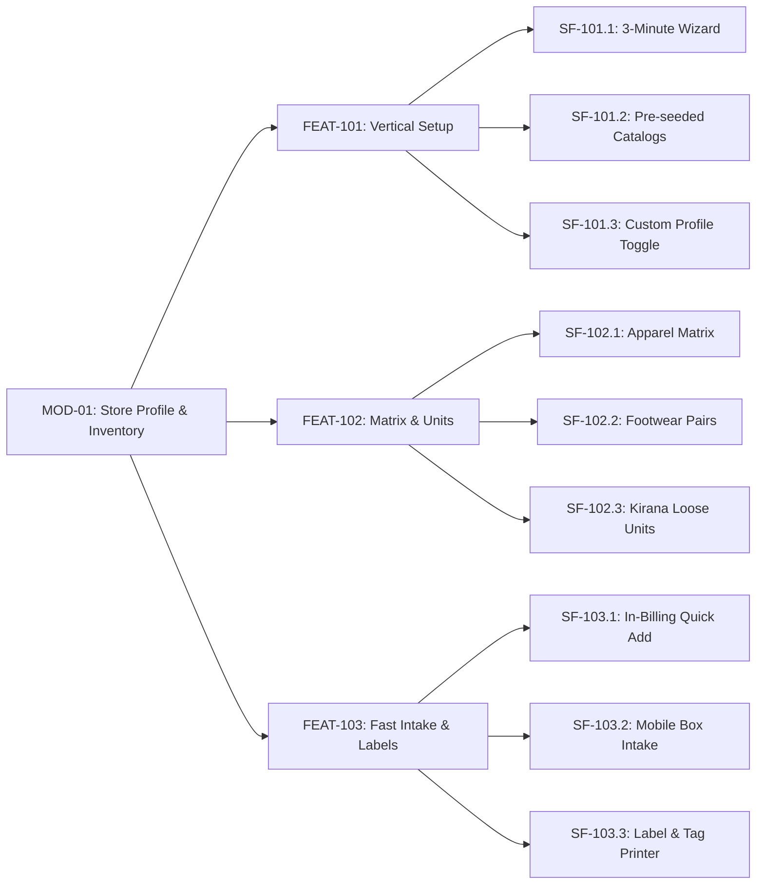
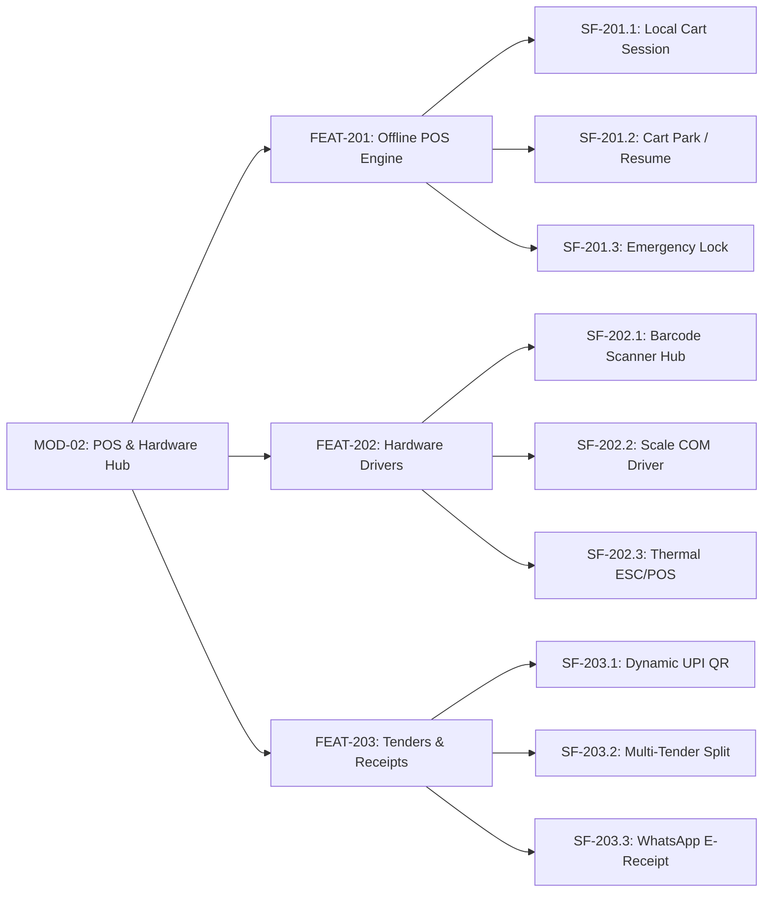
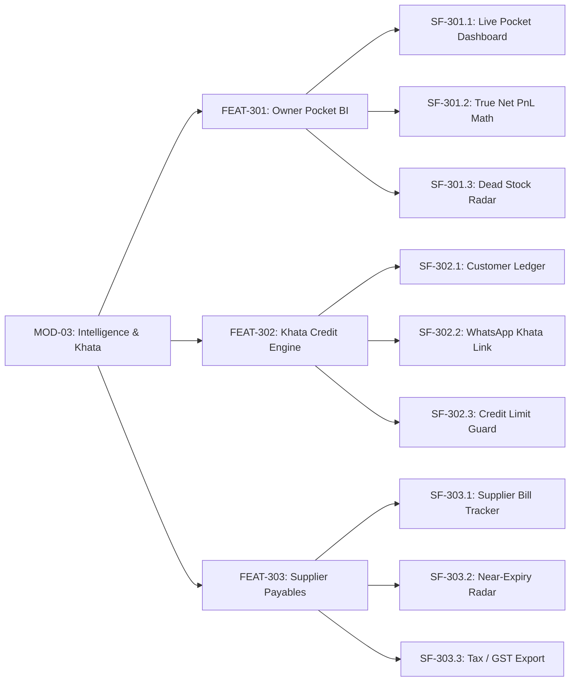
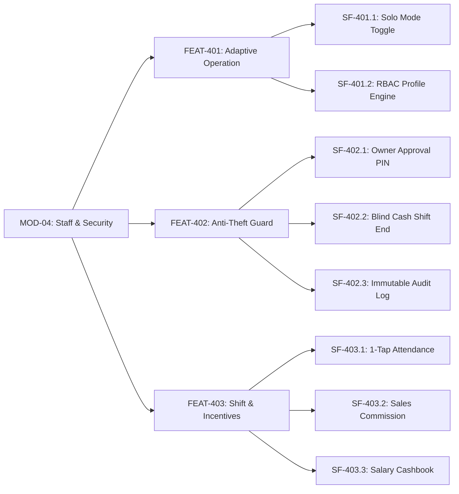
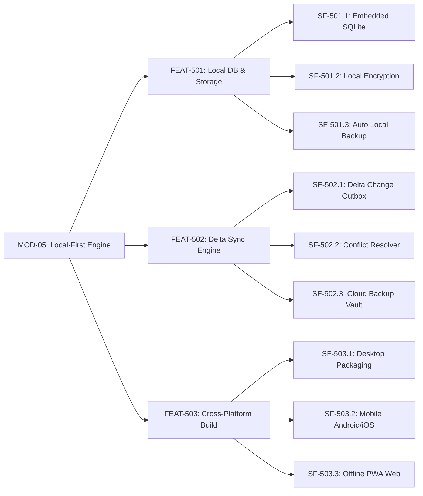
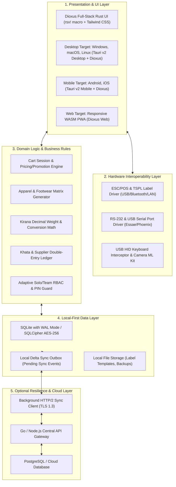
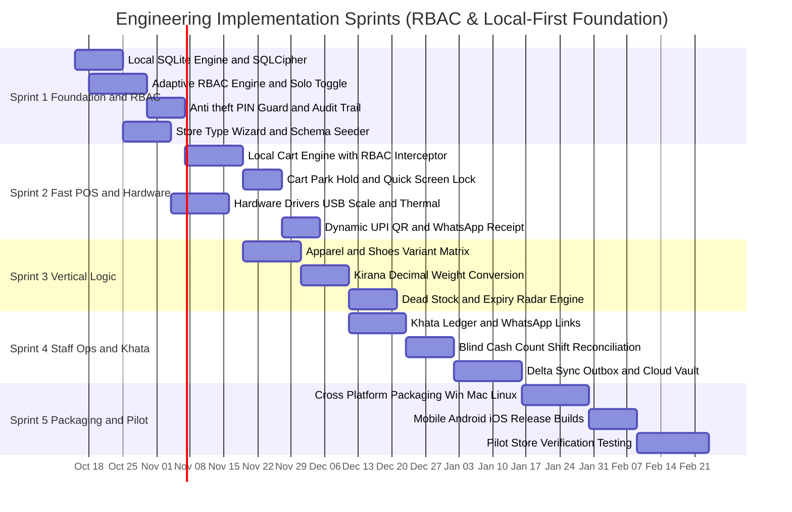

# Capabilities Breakdown & Engineering Work Breakdown Structure (WBS)
## Multi-Platform Local-First Retail Management & ERP System
### Module $\rightarrow$ Feature $\rightarrow$ Sub-Feature Hierarchy with End-to-End Traceability & Technical Stack Mapping

---

## Document Control & Governance

- **Document Identifier:** CAP-RET-2026-V1.0
- **Document Title:** Capabilities Decomposition & Development Mapping Specification
- **Version:** 1.0 (Engineering Baseline)
- **Derived From:** 
  - Business Requirements Document (`docs/brd-retail-store-erp.md`)
  - BPMN Process Workflows (`docs/bpmn-retail-store-erp.md`)
  - Request for Proposal (`docs/rfp-retail-store-erp.md`)
- **Target Audience:** Engineering Leads, System Architects, Full-Stack Engineers, DevOps, and QA Automation Leads
- **Mermaid Syntax Compatibility:** Tested and validated for Mermaid v11.16.0+

---

## 1. High-Level Architectural Tree & Capability Taxonomy

The capabilities of the system are structured into five core business modules and two foundational technical engines:

```mermaid
graph TD
    System["Retail ERP Core System"]

    System --> M1["MOD-01: Store Profile & Dynamic Inventory"]
    System --> M2["MOD-02: POS Billing & Hardware Integration"]
    System --> M3["MOD-03: Business Intelligence & Khata Ledger"]
    System --> M4["MOD-04: Adaptive Staff & Security Engine"]
    System --> M5["MOD-05: Local-First Core & Cloud Delta Sync"]

    M1 --> M1_F1["Vertical Onboarding & Config"]
    M1 --> M1_F2["Variant Matrix & Unit Engine"]
    M1 --> M1_F3["Stock Intake & Barcode Ops"]

    M2 --> M2_F1["High-Velocity Offline Checkout"]
    M2 --> M2_F2["Hardware Peripheral Driver Hub"]
    M2 --> M2_F3["Payment Tenders & Digital Receipts"]

    M3 --> M3_F1["Owner Pocket Analytics"]
    M3 --> M3_F2["Digital Khata Credit System"]
    M3 --> M3_F3["Distributor Payables Tracker"]

    M4 --> M4_F1["Solo vs Team Operating Modes"]
    M4 --> M4_F2["Cash Till & Shift Auditing"]
    M4 --> M4_F3["Staff Attendance & Incentives"]

    M5 --> M5_F1["Embedded Offline Storage"]
    M5 --> M5_F2["Asynchronous Delta Sync Engine"]
    M5 --> M5_F3["Cross-Platform Deployment Runtimes"]
```

---

## 2. Capability Hierarchy: Module $\rightarrow$ Feature $\rightarrow$ Sub-Feature

---

### Module 1: Store Profile & Dynamic Inventory (MOD-01)
**Objective:** Enable solo and small-team retailers to adapt inventory models dynamically to their retail vertical without programming or complex setup.

#### Feature & Sub-Feature Specifications
| Sub-Feature ID | Sub-Feature Name | Technical Scope & Business Logic | Traceability (BRD / BPMN) | Target Layer & Tech Stack |
|:---|:---|:---|:---|:---|
| **SF-101.1** | Store Onboarding Wizard | Step-by-step modal presenting 4 vertical cards (Clothes, Shoes, Kirana, Custom). Automatically applies vertical defaults to SQLite `store_settings`. | `BR-INV-01` `BPMN-1` | UI Layer (Dioxus Rust Components + Tailwind CSS) + Local SQLite Config |
| **SF-101.2** | Pre-seeded Master Catalog | Bundled read-only SQLite SQLite database containing 25,000+ FMCG grocery barcodes (EAN-13, Brand, HSN, Tax Rate) and standard shoe/cloth sizes. | `BR-INV-06` `BPMN-1` | Asset Seed DB + Local SQLite Migration |
| **SF-101.3** | Custom Attribute Toggle | User can toggle attributes (size, color, expiry, weight, batch) dynamically per category. Stored as EAV or JSON column in SQLite. | `BR-INV-01` `BPMN-1` | Local SQLite Schema (`attributes` table) |
| **SF-102.1** | Apparel Variant Matrix Generator | Parent style entity with 2D variant generation (Sizes: XS-XXL $\times$ Colors). Automatically spawns unique child SKUs and individual barcodes. | `BR-INV-02` `BPMN-3` | Domain Logic Engine + SQLite Child Table |
| **SF-102.2** | Footwear Size & Pair Integrity | Multi-standard size mapping (UK/India, US, EU) with Left/Right pair tracking to prevent boxed size mismatches. | `BR-INV-03` `BPMN-3` | Domain Logic Engine + Barcode Resolver |
| **SF-102.3** | Kirana Loose Bulk-to-Retail Unit Math | Handles fractional decimals (up to 3 decimal places). Selling 0.350 kg loose sugar reduces parent 50 kg sack quantity by 0.350. | `BR-INV-04` `BPMN-3` | Math / Inventory Engine (`units` table) |
| **SF-103.1** | In-Billing Fast Item Quick-Add | Floating lightweight modal on the POS checkout screen. Typing Name + Price + Qty saves to SQLite and appends to active cart in $< 10$ seconds. | `BR-INV-05` `BPMN-2` | POS State Controller + Local DB Transaction |
| **SF-103.2** | Mobile Camera Box Intake | Utilizes mobile phone camera to scan master carton barcodes, enter wholesale purchase cost and quantity in 1 step. | `BR-INV-09` `BPMN-3` | Mobile Camera Plugin (Google ML Kit / ZXing) |
| **SF-103.3** | Thermal Label & Barcode Tag Print | Generates raster or ESC/POS / TSPL / ZPL commands for 50x25mm garment tags and shoe box stickers via USB/Bluetooth. | `BR-INV-07` `BPMN-3` | Native Peripheral Driver (ESC/POS / TSPL) |

---

### Module 2: Point of Sale (POS) Billing & Hardware Integration (MOD-02)
**Objective:** Provide sub-100ms offline counter checkout, hardware peripheral communication, flexible tenders, and zero-paper digital receipts.

#### Feature & Sub-Feature Specifications
| Sub-Feature ID | Sub-Feature Name | Technical Scope & Business Logic | Traceability (BRD / BPMN) | Target Layer & Tech Stack |
|:---|:---|:---|:---|:---|
| **SF-201.1** | Local Cart Session & Hotkey Engine | Cart operates in-memory backed by local SQLite. Full keyboard shortcuts: `F2` Quick-Add, `F6` Park, `F9` Cash, `F10` UPI, `Enter` Complete. | `BR-POS-01` `BPMN-2` | POS Presentation Layer + State Machine |
| **SF-201.2** | Multi-Tab Cart Hold & Resume | Allows holding up to 10 active customer carts simultaneously in SQLite memory. 1-tap/F6 park and 1-tap restore. | `BR-POS-06` `BPMN-2` | Local In-Memory Cart Manager |
| **SF-201.3** | Quick Emergency Screen Lock | 1-tap lock button or inactivity timer blanks the screen, locks the till, and requests a 4-digit PIN for resumption. | `BR-POS-08` `BPMN-2` | App Lifecycle & Security Controller |
| **SF-202.1** | Omni-Scanner Driver Hub | Listens to USB HID keyboard events, Bluetooth SPP scanners, and mobile camera barcode stream (UPC, EAN-13, Code 128, QR). | `BR-POS-02` `BPMN-2` | OS Hardware Layer (Raw Input / USB HID) |
| **SF-202.2** | Digital Weighing Scale Driver | Connects via RS-232 COM port / USB Serial / Bluetooth. Parses continuous stream data strings to extract live weight in kg. | `BR-POS-03` `BPMN-2` | SerialPort Library (Windows/Linux/Android) |
| **SF-202.3** | ESC/POS Receipt Printer Engine | Formats raw ESC/POS commands for 58mm (2-inch) and 80mm (3-inch) paper rolls. Dispatches to USB, Bluetooth, LAN, and Wi-Fi printers. | `BR-POS-05` `BPMN-2` | Native ESC/POS Command Builder |
| **SF-203.1** | Dynamic On-Screen UPI QR | Dynamically generates NPCI UPI string (`upi://pay?pa=...&am=XX.XX&tn=Bill#`) and renders high-contrast QR on screen for instant customer scanning. | `BR-POS-04` `BPMN-2` | QR Generator Component + Payment Service |
| **SF-203.2** | Multi-Tender Split Payment | Handles combinations of Cash, UPI, Card, Gift Voucher, and Khata on a single bill with exact change calculations. | `BR-POS-04` `BPMN-2` | Payment Domain Engine |
| **SF-203.3** | WhatsApp & SMS E-Receipt Dispatch | Formats digital receipt summary and deep-links to WhatsApp Web / WhatsApp Business API or SMS gateway without paper print. | `BR-POS-05` `BPMN-2` | Intent / URL Scheme (`wa.me`) & SMS API |

---

### Module 3: Business Intelligence, Stock Health & Khata Ledger (MOD-03)
**Objective:** Provide non-accountant shop owners with pocket visibility into true net profit, dead stock liquidation, customer credit, and vendor dues.

#### Feature & Sub-Feature Specifications
| Sub-Feature ID | Sub-Feature Name | Technical Scope & Business Logic | Traceability (BRD / BPMN) | Target Layer & Tech Stack |
|:---|:---|:---|:---|:---|
| **SF-301.1** | Live Pocket Mobile Dashboard | Lightweight mobile view displaying Today's Sales, Net Margin, Cash in Hand, UPI Collected, and Footfall count. | `BR-BI-01` `BPMN-4` | Mobile UI + Local SQLite View |
| **SF-301.2** | True Net Profit & Expense Math | Real-time calculation: `Net Margin = Total Sales - COGS - (Rent + Electricity + Salaries + Expenses + Discounts)`. | `BR-BI-02` `BPMN-4` | Analytics Computation Engine |
| **SF-301.3** | Dead Stock & Trapped Capital Radar | Queries inventory where `last_sold_date > 60/90 days`. Calculates dollar amount of trapped capital and suggests discount markdowns. | `BR-BI-03` `BPMN-4` | Analytics Engine (SQL Query Optimizer) |
| **SF-302.1** | Digital Customer Khata Ledger | Double-entry customer credit ledger tracking debits (credit purchases) and credits (repayments). Shows running balance. | `BR-BI-04` `BPMN-6` | Financial Ledger Engine (`khata_ledger` table) |
| **SF-302.2** | WhatsApp Payment Reminder Link | Generates pre-filled WhatsApp message with outstanding balance and dynamic UPI payment deep link (`upi://pay?pa=...`). | `BR-BI-04` `BPMN-6` | Messaging Integration Layer |
| **SF-302.3** | Customer Credit Limit Guardrail | Warns or blocks credit checkout if current balance + cart total exceeds customer pre-set credit limit without PIN override. | `BR-BI-04` `BPMN-6` | POS Checkout Validation Rules |
| **SF-303.1** | Supplier Payables Aging Tracker | Logs vendor invoices, credit periods (e.g., 30 days), upcoming due dates, and purchase return debit notes. | `BR-BI-05` `BPMN-3` | Vendor Ledger Component |
| **SF-303.2** | FMCG Near-Expiry Early Warning | Alerts for food/grocery products expiring within 15/30/60 days. Generates return-to-vendor debit note report. | `BR-INV-08` `BR-BI-04` | Background Chrono-Worker / Expiry Index |
| **SF-303.3** | 1-Click Tax / GST / VAT Export | Formats monthly B2B and B2C sales and purchase reports into clean Excel/CSV/PDF for local accountants. | `BR-BI-06` | Data Exporter (Apache POI / CSV Generator) |

---

### Module 4: Adaptive Staff Management & Theft Prevention (MOD-04)
**Objective:** Maintain zero friction in solo mode while providing anti-theft controls, blind cash shift audits, and sales commissions when adding employees.

#### Feature & Sub-Feature Specifications
| Sub-Feature ID | Sub-Feature Name | Technical Scope & Business Logic | Traceability (BRD / BPMN) | Target Layer & Tech Stack |
|:---|:---|:---|:---|:---|
| **SF-401.1** | Solo Mode Adaptive UI Toggle | When enabled, hides all employee, shift, and permission menus, keeping the UI minimal and focused on fast 1-person billing. | `BR-EMP-01` `BPMN-4` | Presentation Layer UI State Machine |
| **SF-401.2** | Role-Based Access Control (RBAC) | Pre-configured roles: `Owner` (Full access), `Cashier` (Billing only; hides profit/COGS), `Helper` (Stock check only). | `BR-EMP-02` `BPMN-4` | Authorization Middleware / Security Context |
| **SF-402.1** | Anti-Theft Owner Approval PIN | Intercepts cart line voids, bill deletions, discounts $> \$X$, and cash refunds; requires Owner 4-digit Master PIN. | `BR-EMP-03` `BPMN-2` | POS Action Interceptor / Guard Service |
| **SF-402.2** | Blind Cash Count Shift Closure | In Team Mode, cashier inputs physical denomination count without seeing system expected cash. System flags shortage/excess. | `BR-EMP-04` `BPMN-4` | Shift Reconciliation Controller |
| **SF-402.3** | Append-Only Immutable Audit Log | Logs every sensitive action (discounts, voids, drawer open, price override) with device ID, user ID, and timestamp. | `NFR-SEC-01` `BPMN-4` | SQLite Append-Only Table (`audit_logs`) |
| **SF-403.1** | 1-Tap Staff Attendance Logging | Fast clock-in / clock-out on POS counter or owner mobile app; calculates working hours and half-days. | `BR-EMP-05` | HR / Attendance Component |
| **SF-403.2** | Salesperson Tagging & Commission | Assigns salesperson to cart lines (crucial for apparel & shoe stores); calculates monthly sales volume and incentive payouts. | `BR-EMP-06` | Sales Attribution Service |
| **SF-403.3** | Staff Petty Advance Cashbook | Records daily petty salary advances given from cash drawer; automatically deducts from month-end salary calculations. | `BR-EMP-05` | Payroll / Cashbook Ledger |

---

### Module 5: Local-First Core, Hardware Drivers & Cloud Delta Sync (MOD-05)
**Objective:** Provide the underlying architectural engine ensuring 100% offline autonomy, rapid data synchronization, and cross-platform native performance.

#### Feature & Sub-Feature Specifications
| Sub-Feature ID | Sub-Feature Name | Technical Scope & Business Logic | Traceability (BRD / BPMN) | Target Layer & Tech Stack |
|:---|:---|:---|:---|:---|
| **SF-501.1** | Embedded SQLite Database Engine | High-performance local SQL database with WAL (Write-Ahead Logging) mode enabled for sub-10ms transactional writes. | `BR-POS-01` `NFR-DATA-01` | SQLite / Room / Drift / CoreData |
| **SF-501.2** | Local Database Encryption | SQLCipher / AES-256 local database encryption protecting customer data and financial numbers at rest. | `NFR-DATA-03` | SQLCipher / OS Keystore / Keychain |
| **SF-501.3** | Automatic Local Backup to USB/SD | Automated periodic database dumps to local USB flash drive or phone microSD card; 1-click restore mechanism. | `NFR-DATA-03` | OS File System I/O Worker |
| **SF-502.1** | Delta Change Log Outbox | Local append-only outbox table recording changed rows with sequence IDs and timestamps (`status: pending_sync`). | `NFR-DATA-02` `BPMN-5` | Outbox Pattern / SQLite Trigger Bus |
| **SF-502.2** | Conflict-Free Reconciler (CRDT) | Resolves concurrent offline edits across devices: stock decrements are additive; customer khata balances use transaction logs. | `NFR-DATA-02` `BPMN-5` | Sync Domain Service (CRDT / LWW) |
| **SF-502.3** | Encrypted Cloud Backup Vault | Optional cloud backup to Google Drive / Dropbox or private cloud when internet is available; encrypted prior to upload. | `NFR-DATA-03` `BPMN-5` | Cloud Storage API (OAuth2 + AES-GCM) |
| **SF-503.1** | Desktop Native Packaging | Bundles standalone installers: Windows (MSI/EXE), macOS (DMG Universal), Linux (DEB/AppImage). | `NFR-UX-01` `NFR-PERF-01` | Tauri v2 Desktop (Rust + Webview) |
| **SF-503.2** | Mobile Native Compilation | Compiles native binaries for Android (APK/AAB) and iOS (IPA) with background barcode scanning and Bluetooth drivers. | `NFR-PERF-02` | Tauri v2 Mobile (Kotlin/Swift Plugins + Webview) |
| **SF-503.3** | Offline Progressive Web App (PWA) | Browser distribution utilizing Service Workers, WebAssembly (WASM), and IndexedDB/OPFS for offline browser billing. | `NFR-UX-01` | Web PWA + WASM SQLite |

---

## 3. Technology Stack Mapping & Architectural Layering

---

## 4. End-to-End Capabilities Traceability Matrix

This table bridges the business expectations directly into software capabilities and engineering components:

| Module | Feature | Sub-Feature ID | RFP Requirement | BRD Requirement | BPMN Process | Engineering Component |
|:---|:---|:---|:---:|:---:|:---:|:---|
| **MOD-01** | Vertical Config | **SF-101.1** | `FR-SET-01` | `BR-INV-01` | `BPMN-1` | `OnboardingWizardController` |
| **MOD-01** | Master Data | **SF-101.2** | `FR-SET-05` | `BR-INV-06` | `BPMN-1` | `FMCGDatabaseSeeder` |
| **MOD-01** | Custom Schemas | **SF-101.3** | `FR-SET-02` | `BR-INV-01` | `BPMN-1` | `DynamicAttributeRepository` |
| **MOD-01** | Matrix Variants | **SF-102.1** | `FR-INV-01` | `BR-INV-02` | `BPMN-3` | `ApparelMatrixService` |
| **MOD-01** | Shoe Pairs | **SF-102.2** | `FR-INV-01` | `BR-INV-03` | `BPMN-3` | `FootwearVariantService` |
| **MOD-01** | Loose Weights | **SF-102.3** | `FR-INV-02` | `BR-INV-04` | `BPMN-3` | `UnitConversionService` |
| **MOD-01** | Fast Intake | **SF-103.1** | `FR-SET-04` | `BR-INV-05` | `BPMN-2` | `QuickAddModalController` |
| **MOD-01** | Mobile Intake | **SF-103.2** | `FR-INV-06` | `BR-INV-09` | `BPMN-3` | `MobileCameraScannerService` |
| **MOD-01** | Label Printing | **SF-103.3** | `FR-INV-04` | `BR-INV-07` | `BPMN-3` | `ThermalLabelPrintService` |
| **MOD-02** | Local Billing | **SF-201.1** | `FR-POS-01` | `BR-POS-01` | `BPMN-2` | `CartSessionManager` |
| **MOD-02** | Cart Park | **SF-201.2** | `FR-POS-07` | `BR-POS-06` | `BPMN-2` | `CartParkingRepository` |
| **MOD-02** | Screen Lock | **SF-201.3** | `NFR-UX-04` | `BR-POS-08` | `BPMN-2` | `AppLockController` |
| **MOD-02** | Barcode Drivers| **SF-202.1** | `FR-POS-02` | `BR-POS-02` | `BPMN-2` | `BarcodeScannerDriverHub` |
| **MOD-02** | Scale Drivers | **SF-202.2** | `FR-POS-03` | `BR-POS-03` | `BPMN-2` | `SerialPortScaleDriver` |
| **MOD-02** | Thermal Print | **SF-202.3** | `FR-POS-05` | `BR-POS-05` | `BPMN-2` | `EscPosPrinterService` |
| **MOD-02** | UPI Payments | **SF-203.1** | `FR-POS-04` | `BR-POS-04` | `BPMN-2` | `UpiQrGeneratorService` |
| **MOD-02** | Split Tenders | **SF-203.2** | `FR-POS-03` | `BR-POS-04` | `BPMN-2` | `TenderSplitCalculator` |
| **MOD-02** | WhatsApp Bills| **SF-203.3** | `FR-POS-05` | `BR-POS-05` | `BPMN-2` | `WhatsAppReceiptLauncher` |
| **MOD-03** | Pocket BI | **SF-301.1** | `FR-BI-01` | `BR-BI-01` | `BPMN-4` | `OwnerDashboardController` |
| **MOD-03** | Net Profit Math| **SF-301.2** | `FR-BI-02` | `BR-BI-02` | `BPMN-4` | `TrueProfitCalculationService` |
| **MOD-03** | Dead Stock | **SF-301.3** | `FR-BI-03` | `BR-BI-03` | `BPMN-4` | `DeadStockRadarService` |
| **MOD-03** | Khata Ledger | **SF-302.1** | `FR-BI-05` | `BR-BI-04` | `BPMN-6` | `CustomerKhataLedgerService` |
| **MOD-03** | WhatsApp Khata| **SF-302.2** | `FR-BI-05` | `BR-BI-04` | `BPMN-6` | `KhataReminderService` |
| **MOD-03** | Credit Limits | **SF-302.3** | `FR-CRM-01` | `BR-BI-04` | `BPMN-6` | `CreditLimitValidator` |
| **MOD-03** | Supplier Dues | **SF-303.1** | `FR-BI-06` | `BR-BI-05` | `BPMN-3` | `SupplierPayablesService` |
| **MOD-03** | Expiry Radar | **SF-303.2** | `FR-INV-03` | `BR-INV-08` | `BPMN-3` | `ExpiryRadarService` |
| **MOD-03** | Tax Export | **SF-303.3** | `FR-FIN-03` | `BR-BI-06` | `BPMN-4` | `TaxReportExporter` |
| **MOD-04** | Solo UI Toggle| **SF-401.1** | `FR-EMP-01` | `BR-EMP-01` | `BPMN-4` | `OperationModeStateManager` |
| **MOD-04** | Staff RBAC | **SF-401.2** | `FR-EMP-01` | `BR-EMP-02` | `BPMN-4` | `RbacSecurityMiddleware` |
| **MOD-04** | Anti-Theft PIN| **SF-402.1** | `FR-EMP-02` | `BR-EMP-03` | `BPMN-2` | `OwnerPinAuthorizer` |
| **MOD-04** | Blind Count | **SF-402.2** | `FR-EMP-03` | `BR-EMP-04` | `BPMN-4` | `BlindCashAuditController` |
| **MOD-04** | Audit Log | **SF-402.3** | `NFR-SEC-01` | `NFR-DATA-04`| `BPMN-4` | `ImmutableAuditLogService` |
| **MOD-04** | Attendance | **SF-403.1** | `FR-EMP-04` | `BR-EMP-05` | `BPMN-4` | `StaffAttendanceService` |
| **MOD-04** | Commission | **SF-403.2** | `FR-EMP-05` | `BR-EMP-06` | `BPMN-2` | `CommissionCalculationEngine` |
| **MOD-04** | Salary Book | **SF-403.3** | `FR-EMP-06` | `BR-EMP-05` | `BPMN-4` | `PettySalaryAdvanceLedger` |
| **MOD-05** | Embedded DB | **SF-501.1** | `NFR-SYNC-01`| `NFR-DATA-01`| `BPMN-5` | `SqliteDatabaseManager` |
| **MOD-05** | DB Encryption | **SF-501.2** | `NFR-SEC-02` | `NFR-DATA-03`| `BPMN-5` | `SqlCipherSecurityProvider` |
| **MOD-05** | Local Backup | **SF-501.3** | `NFR-SYNC-03`| `NFR-DATA-03`| `BPMN-5` | `LocalBackupWorker` |
| **MOD-05** | Delta Outbox | **SF-502.1** | `NFR-SYNC-02`| `NFR-DATA-02`| `BPMN-5` | `DeltaOutboxEventBus` |
| **MOD-05** | CRDT Resolver | **SF-502.2** | `NFR-SYNC-01`| `NFR-DATA-02`| `BPMN-5` | `ConflictResolutionEngine` |
| **MOD-05** | Cloud Vault | **SF-502.3** | `NFR-SYNC-03`| `NFR-DATA-03`| `BPMN-5` | `CloudVaultSyncService` |
| **MOD-05** | Desktop Build | **SF-503.1** | `NFR-UX-01` | `NFR-PERF-01`| `BPMN-5` | `DesktopDistributionPipeline` |
| **MOD-05** | Mobile Build | **SF-503.2** | `NFR-UX-01` | `NFR-PERF-02`| `BPMN-5` | `MobileDistributionPipeline` |
| **MOD-05** | Web PWA Build | **SF-503.3** | `NFR-UX-01` | `NFR-PERF-01`| `BPMN-5` | `PwaWasmDistributionPipeline` |

---

## 5. Engineering Implementation Roadmap & Sprints

> **Architecture Principle: Security & RBAC-First Foundation**  
> RBAC (`SF-401.2`), Solo Mode Toggle (`SF-401.1`), and the Anti-Theft Guard (`SF-402.1`) are established in **Sprint 1** directly alongside the Local SQLite Storage engine. Building RBAC first ensures that user sessions, permission checks, and audit trails are baked into every data model from day one—preventing expensive security refactoring later.

