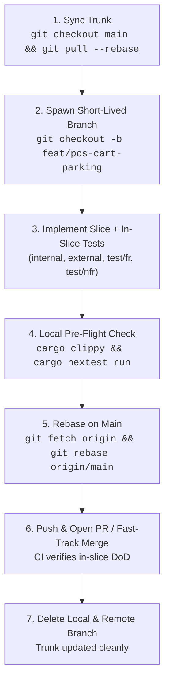
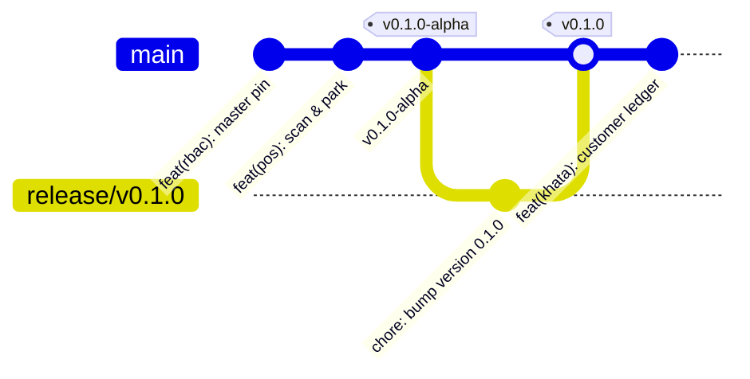
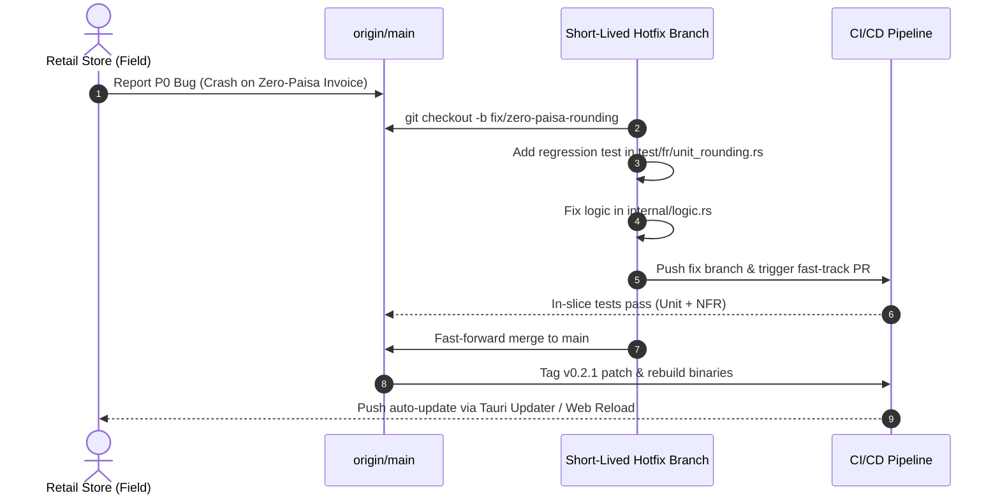

# Git Strategy: Scaled Trunk-Based Development (TBD)
**Document Version:** 1.0  
**Project:** RetailOS / Store ERP (Dioxus 0.7 + Tauri v2.12 + SQLCipher)  
**Author:** Veteran System Architect & Release Engineer  
**Date:** October 2026  
**Status:** Approved for Implementation  

---

## 1. Executive Summary & Philosophy

RetailOS is developed using **Scaled Trunk-Based Development (TBD)**. In contrast to legacy branching workflows (e.g., GitFlow) that introduce merge debt, long-lived staging branches, and delayed integration failures, Trunk-Based Development treats `main` as the single immutable source of truth that is **always releasable**.

```
                (Short-Lived Feature Branches: < 24 Hours)
                 feat/pos-cart-parking
                o---o---o
               /         \ (Squash & Merge)
---(main)-----o-----------o-----------------------o--------------------o---> (Releasable at all times)
                           \                     /
                            o---o---------------o (Rebase & Fast-Forward)
                             fix/khata-decimal-rounding
```

### Core Principles
1. **Single Source of Truth (`main`)**: There is only one perpetual branch: `main`. No long-running `develop`, `feature-staging`, or `qa` branches.
2. **Ephemeral Branches**: Feature, bugfix, and chore branches are short-lived (lifespan **< 24 hours**, typically 2–6 hours, max 100–300 lines of diff).
3. **Continuous Verification via Vertical Slice Architecture (VSA)**: Every feature branch maps to an isolated vertical slice containing its own `test/fr/` (Functional) and `test/nfr/` (Non-Functional) suites. CI executes the slice-level tests before code can enter `main`.
4. **Feature Toggles (Dark Launching)**: Incomplete features are committed directly to `main` hidden behind zero-cost compile-time or runtime feature flags.
5. **No Broken Windows on `main`**: A broken build on `main` is treated as a P0 emergency. Fixing or reverting the offending commit takes precedence over new development.

---

## 2. Branching Taxonomy & Naming Conventions

All branch names must follow strict semantic prefixes. Slashes `/` separate category from context; hyphens `-` separate tokens within context.

| Branch Prefix | Typical Lifespan | Target Base | Purpose | Example |
| :--- | :--- | :--- | :--- | :--- |
| `feat/` | 2 – 12 hours | `main` | New vertical slice or incremental slice sub-feature | `feat/pos-cart-parking`, `feat/kirana-weight-scale` |
| `fix/` | 1 – 4 hours | `main` | Corrective patch for logic, UI, or security bug | `fix/khata-decimal-rounding`, `fix/argon2-salt-length` |
| `refactor/` | 2 – 8 hours | `main` | Structural code improvement without altering behavior | `refactor/core-db-connection-pool` |
| `nfr/` | 2 – 8 hours | `main` | Dedicated performance tuning or security hardening | `nfr/opfs-sqlite-vacuum`, `nfr/pos-checkout-benchmark` |
| `chore/` | 1 – 4 hours | `main` | Tooling, dependencies, CI/CD scripts, docs | `chore/bump-dioxus-0-7-2`, `chore/setup-cargo-deny` |
| `release/` | 1 – 2 hours *(Read-Only)* | Tag on `main` | Ephemeral release stabilization (if emergency cherry-pick needed) | `release/v0.1.0` |

> [!WARNING]
> **Branch Lifespan Cap**: Any branch older than 24 hours without a merged PR is considered stale and must be re-synced with `main` via `git rebase origin/main`. If a feature is too large for a 24-hour cycle, it **must** be broken down into smaller slices or committed behind a feature flag.

---

## 3. Commit Message Specification (Conventional Commits v1.0.0)

RetailOS enforces the **Conventional Commits** specification. Commit messages feed directly into automated semantic changelog generators (`git-cliff`).

### 3.1 Format Structure
```
<type>(<scope>): <short imperative summary>

[optional body explaining motivation, context, and non-obvious trade-offs]

[optional footer: closes #issue, BREAKING CHANGE, or FR/NFR marker]
```

### 3.2 Types & Scopes
- **Types**:
  - `feat`: A new user-facing capability or slice enhancement.
  - `fix`: A bug fix.
  - `perf`: Code change that improves performance (NFR).
  - `security`: Security enhancement or vulnerability patch (NFR).
  - `test`: Adding or correcting tests (FR/NFR) without changing production code.
  - `refactor`: Code change that neither fixes a bug nor adds a feature.
  - `style`: Changes to `style.css` or Tailwind classes without logic alterations.
  - `chore`: Build process, auxiliary tools, or dependency updates.
  - `docs`: Documentation updates only.

- **Scopes (Strictly mapped to Workspace Packages and Vertical Slices)**:
  - `core-db`, `core-hardware`, `core-security`, `core-ui` (Platform foundation crates)
  - `rbac`, `pos`, `inventory`, `khata`, `analytics`, `store-settings` (Feature slices)
  - `ci`, `deps`, `wasm`, `tauri` (Cross-cutting infrastructure)

### 3.3 Commit Examples
```git
feat(pos): implement dual-currency cash counter & soft tender breakdown

- Added internal/models.rs SplitTender struct
- Added external/components/split_tender_modal.rs with SoftMorph styling
- Added test/fr/unit_split_tender.rs & test/nfr/perf_modal_render.rs

Closes #42
FR-TRACE: FR-POS-02
```

```git
fix(khata): prevent 3-decimal float precision creep in Kirana ledger

Replaced standard f64 accumulation with rust_decimal::Decimal to ensure
exact paisa bookkeeping during bulk grain distribution.

FR-TRACE: FR-KHT-04
```

```git
nfr(core-db): optimize SQLite B-tree page cache for OPFS WASM target

Configures PRAGMA cache_size = -64000 (64MB) and PRAGMA mmap_size = 268435456.
Reduces barcode lookup latency from 1.4ms to 0.18ms in Criterion benchmark.

NFR-TRACE: NFR-PERF-01
```

---

## 4. Daily Developer & AI Agent Workflow

To avoid merge conflicts and maximize velocity, developers and autonomous AI agents follow this strict 6-step loop:



### Step 1: Sync Trunk Daily & Often
```bash
git checkout main
git pull --rebase origin main
```

### Step 2: Spawn Ephemeral Branch
```bash
git checkout -b feat/pos-cart-parking
```

### Step 3: Implement Within the Vertical Slice
Work strictly within the slice boundaries:
- `src/features/pos_cart_parking/internal/`
- `src/features/pos_cart_parking/external/` (including `style.css`)
- `src/features/pos_cart_parking/test/fr/`
- `src/features/pos_cart_parking/test/nfr/`
- `src/features/pos_cart_parking/SLICE.md` (Update token-efficient manifest)

### Step 4: Run Local Pre-Flight Checks
Before staging any commit, run the identical commands executed by CI:
```bash
# 1. Format check
cargo fmt --all -- --check

# 2. Strict linting
cargo clippy --all-targets --all-features -- -D warnings

# 3. Fast slice-level testing
cargo nextest run --package feature-pos-cart-parking

# 4. Security audit
cargo audit
```

### Step 5: Rebase Immediately Before Push
Never merge `main` into your feature branch (`no merge commits in PR history`). Always rebase:
```bash
git fetch origin main
git rebase origin/main
```
If conflicts arise, resolve them locally where context is fresh.

### Step 6: Push & Merge
```bash
git push -u origin feat/pos-cart-parking
```
Merge strategy: **Squash and Merge** (for multi-commit micro-iterations) or **Rebase and Fast-Forward** (for atomic, clean single-commit features).

---

## 5. In-Slice Definition of Done (DoD) as Quality Gate

Under Trunk-Based Development, code cannot enter `main` without passing the **In-Slice Definition of Done** specified in `docs/architecture.md`. The quality gate is continuous and automated.

```
+-------------------------------------------------------------------------------+
|                       TRUNK MERGE QUALITY GATE (CI)                           |
+-------------------------------------------------------------------------------+
|  [x] Static Quality    : cargo fmt (clean) & cargo clippy (-D warnings)       |
|  [x] Security Audit    : cargo-audit (0 high/crit) & cargo-deny (clean)       |
|  [x] In-Slice FR Tests : cargo nextest run (100% unit, integration, RBAC)     |
|  [x] In-Slice NFR Perf : criterion (POS checkout < 50ms, Barcode < 5ms)       |
|  [x] In-Slice NFR Sec  : SQL injection fuzz & Zero Master PIN leakage in logs |
|  [x] Token Docs        : SLICE.md updated (< 30 lines, < 250 tokens)          |
|  [x] Style Isolation   : style.css scoped to slice prefix (no global leaks)  |
+-------------------------------------------------------------------------------+
```

---

## 6. Feature Flags (Dark Launching & Decoupled Deployment)

Because feature branches live for less than 24 hours, incomplete features or large milestones must be committed to `main` without exposing unready UI or logic to end users.

### 6.1 Compile-Time Flags (`Cargo.toml`)
Used for platform-specific capabilities (e.g., native hardware barcode scanning vs. Web OPFS camera scanner):
```toml
[features]
default = ["web-sqlite"]
web-sqlite = ["dep:indexed_db_futures"]
desktop-hardware = ["dep:serialport", "dep:rusqlite"]
experimental-pocket-bi = []
```

### 6.2 Runtime Feature Toggles (`FeatureGate`)
Used for progressive feature rollout and Solo Mode vs. Dual Operator modes:

```rust
// In packages/core-security/src/feature_flags.rs
#[derive(Debug, Clone, Copy, PartialEq, Eq)]
pub enum FeatureToggle {
    KhataCreditLimitEnforcement,
    DualCurrencyTender,
    PocketBiProfitForecasting,
    WeightScaleLiveFeed,
}

impl FeatureToggle {
    pub fn is_enabled(&self, store_config: &StoreSettings) -> bool {
        match self {
            Self::PocketBiProfitForecasting => store_config.enable_experimental_bi,
            Self::WeightScaleLiveFeed => store_config.has_weighing_scale,
            _ => true,
        }
    }
}
```

In UI components:
```rust
if FeatureToggle::PocketBiProfitForecasting.is_enabled(&settings) {
    rsx! { ProfitForecastingCard { data: analytics_data } }
}
```

---

## 7. Release & Tagging Strategy

Under TBD, **deployment is decoupled from release**. Every green commit on `main` produces a deployable build artifact (WASM binary or Tauri desktop/mobile installer).



### 7.1 Semantic Versioning (SemVer 2.0.0)
Version numbers follow `MAJOR.MINOR.PATCH`:
- **MAJOR**: Breaking schema migration or fundamental UI overhaul.
- **MINOR**: New vertical slice delivered (e.g., `inventory_variant_matrix`, `khata_ledger`).
- **PATCH**: Bug fix, performance optimization, or security patch.

### 7.2 Release Tagging Pipeline
When a milestone is reached:
1. Ensure `main` is completely green across all platforms (Web WASM, Linux, Windows, macOS, Android).
2. Generate semantic changelog:
   ```bash
   git-cliff --tag v0.2.0 -o CHANGELOG.md
   git commit -am "chore(release): prepare v0.2.0"
   ```
3. Tag the commit on `main`:
   ```bash
   git tag -a v0.2.0 -m "Release v0.2.0: Dynamic Retail Matrix & POS Checkout"
   git push origin v0.2.0
   ```
4. CI detects tag `v*.*.*` and triggers the cross-platform release matrix:
   - Compiles Dioxus Web WASM bundle -> deploys to Web Hosting / OPFS sandbox.
   - Compiles Tauri v2 native bundles:
     - `.deb` / `.AppImage` (Linux)
     - `.msi` / `.exe` (Windows)
     - `.dmg` (macOS)
     - `.apk` / `.aab` (Android)

---

## 8. Hotfix Protocol on Trunk

If a high-severity bug is detected in a live store build:



1. **No Forked Hotfix Branches**: Hotfixes are developed on `fix/<issue-name>` branched directly off the latest `main`.
2. **Mandatory Regression Test**: A hotfix commit must contain a failing unit/integration test reproducing the issue in `test/fr/` or `test/nfr/` before the fix is accepted.
3. **Emergency Merge**: The hotfix is merged to `main`, tagged with a PATCH increment (e.g., `v0.2.1`), and immediately built by the release pipeline.

---

## 9. Monorepo Git Hygiene & Maintenance Rules

### 9.1 `.gitignore` Architecture
Ensure local database locks, WASM targets, and SQLCipher key files never leak into Git history:
```gitignore
# Rust build artifacts
/target/
**/*.rs.bk
Cargo.lock.bak

# Dioxus Web build
/dist/
/.dioxus/

# Node / Tailwind build artifacts (if applicable)
node_modules/
*.css.map

# SQLite & Database storage
*.db
*.sqlite
*.sqlite3
*.db-shm
*.db-wal
/data/
/storage/

# Tauri build artifacts
/src-tauri/target/
/gen/

# Secrets, keys, hardware profiles
*.key
*.pem
.env
.env.*
!.env.example
```

### 9.2 Git Hooks via `cargo-husky` / Simple Git Hooks
Pre-commit hooks are configured to run within **< 2 seconds**:
```bash
# .git/hooks/pre-commit
#!/bin/sh
set -e

# Fast format check
cargo fmt --all -- --check

# Fast check on modified files
cargo check --tests
```

Full nextest suites and clippy run in the pre-push hook:
```bash
# .git/hooks/pre-push
#!/bin/sh
set -e

cargo clippy --all-targets --all-features -- -D warnings
cargo nextest run
```

---

## 10. Summary: Git Strategy Command Cheatsheet

| Intent | Git Command |
| :--- | :--- |
| **Start Feature** | `git checkout main && git pull --rebase && git checkout -b feat/<slice-name>` |
| **Verify Local Slice** | `cargo clippy && cargo nextest run --package feature-<slice-name>` |
| **Re-sync with Trunk** | `git fetch origin main && git rebase origin/main` |
| **Stage & Commit** | `git add . && git commit -m "feat(<scope>): <description>"` |
| **Push Branch** | `git push -u origin feat/<slice-name>` |
| **Squash & Merge PR** | Web UI or `gh pr merge --squash --delete-branch` |
| **Tag New Release** | `git tag -a v0.1.0 -m "Release v0.1.0" && git push origin v0.1.0` |
| **Nuke Local Stale Branches** | `git fetch -p && git branch -vv \| grep ': gone]' \| awk '{print $1}' \| xargs git branch -D` |

---
*This strategy guarantees zero merge-hell, zero stale branches, complete traceability against the RTM, and guarantees that RetailOS remains 100% releasable on every single commit.*
