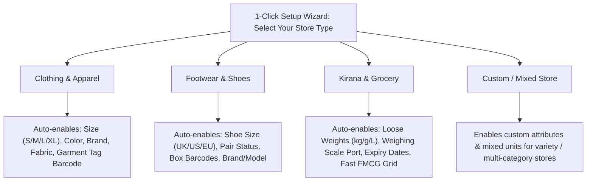
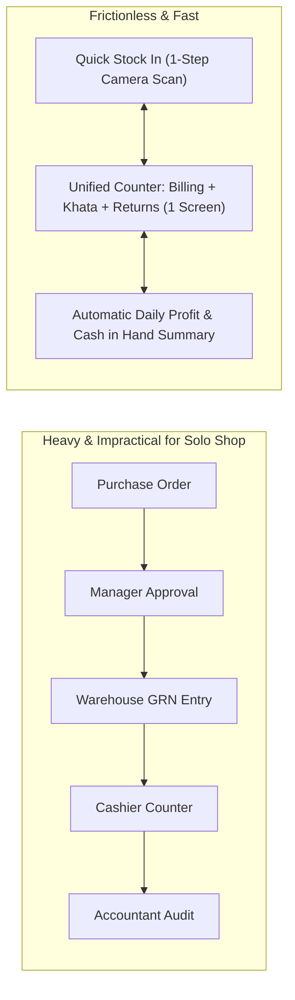
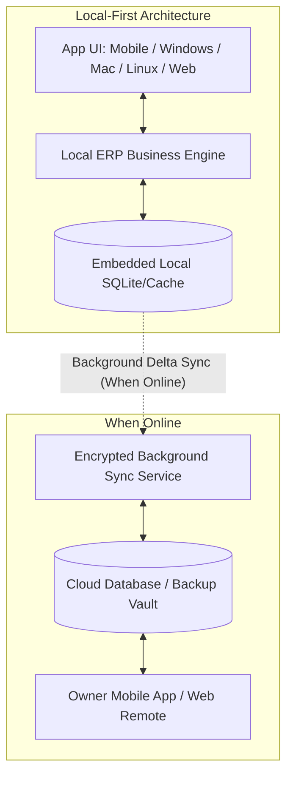
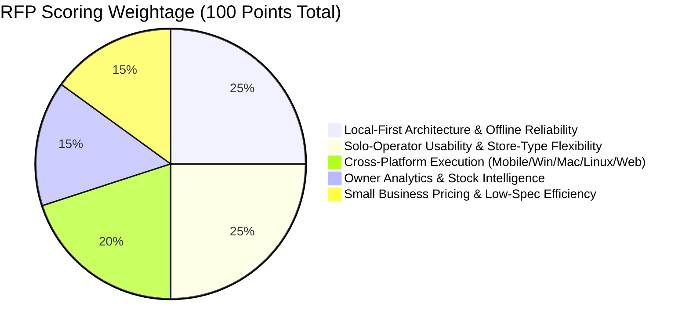

# Request for Proposal (RFP)
## Local-First, Multi-Platform Retail ERP & Store Management Software for Small Retail Businesses
### Tailored for Solo-Operator & Small Teams in Clothing, Footwear, and Kirana / Grocery Stores

---

**Document Control**
- **Document Title:** Request for Proposal (RFP) – Local-First, User-Configurable Multi-Platform Retail ERP
- **Document Version:** 3.0 (Local-First, Solo/Duo Operator & Dynamic Store Type Focus)
- **Target Retail Segments:** Small Retail Shops (Apparel & Clothing, Footwear/Shoes, Kirana & General Grocery, Mixed Variety Retail)
- **Primary Operational Model:** 1 to 2 person stores (Solo shopkeeper mode) scaling to small employee teams
- **Architecture Standard:** **Local-First & Offline-Native** (Zero cloud dependency required for day-to-day operations)
- **Supported Platforms:** Mobile (Android & iOS), Desktop (Windows, macOS, Linux), and Modern Web Browsers
- **Issue Date:** October 12, 2026
- **Response Deadline:** November 20, 2026
- **Issuing Authority:** Retail Operations & Technology Advisory Group
- **Contact:** `procurement@retailerp.example.com`

---

## 1. Executive Summary & Purpose

### 1.1 Purpose
This Request for Proposal (RFP) solicits competitive bids from software developers, solution providers, and system architects to engineer or supply a **lightweight, local-first, multi-platform Retail ERP and Store Management Software**.

### 1.2 Core Problem & The "1–2 Person Shop" Reality
In the vast majority of small retail shops (clothing boutiques, neighborhood shoe stores, local kiranas), the reality is:
- **Solo / Duo Operation:** The shop is operated by just **one person (the owner)** or at most **two people (owner + helper or family member)**. The single operator is simultaneously the cashier, inventory receiver, stock boy, accountant, and customer salesperson.
- **The Failure of Enterprise & Cloud-Only Systems:** 
  - Enterprise ERPs require complex multi-step workflows (e.g., separate PO approval, GRN creation, billing cashier, reconciliation clerk) that paralyze a solo shopkeeper.
  - Cloud-dependent apps crash or stall when local internet is unreliable, slow, or expensive.
  - Generic retail software forces rigid schemas; a kirana store is forced to deal with shoe sizes, or a clothing store cannot easily add size/color variations without technical assistance.

### 1.3 Vision & Key Objectives
The objective is to deliver a software experience where:
1. **The App is 100% "Local-First":** Data lives securely on the shopkeeper's local device first (SQLite / embedded local database). The application is fully functional with **zero internet**. Cloud synchronization and automated backup are strictly optional add-ons, not blockers.
2. **"Single-Operator / Solo Mode":** A 1-click frictionless interface where a single person can handle billing, quick stock intake, customer khata, and cash counting from one screen without jumping through tedious menus.
3. **User-Controlled Shop Type Configuration:** At setup or any time later, the shopkeeper chooses their shop type (**Clothing**, **Footwear**, **Kirana / Grocery**, or **Custom / Hybrid**). The software dynamically configures the inventory schemas, units of measure, barcode behavior, and billing fields to match.
4. **Universal Multi-Platform Support:** Seamless operation on **Mobile (Android & iOS)**, **Desktop (Windows, macOS, Linux)**, and **Web**, sharing a consistent, intuitive user experience.
5. **Actionable Owner Insights & Progressive Team Management:** Visual, simple profit & loss analysis, dead stock warnings, and an employee management module that stays completely unobtrusive when operating solo, but activates seamlessly when hiring staff.

---

## 2. Dynamic Store Type & Inventory Personalization (User-Controlled)

The software must put the power in the shopkeeper's hands. During initial setup (or via Store Settings), the user selects their store archetype or builds a custom hybrid store:

### 2.1 Dynamic Attribute Engine
The inventory schema must be dynamic rather than hardcoded:
- **Clothing / Apparel Profile:** Automatically enables matrix variants (e.g., Parent: "Cotton Shirt", Children: "Size 40 - Blue", "Size 42 - White"), seasonal tags, and alteration notes.
- **Footwear Profile:** Automatically enables shoe size standards (UK, US, EU), box barcode scanning, and pair exchange checks.
- **Kirana / Grocery Profile:** Automatically enables dual-unit conversions (Bulk 50kg bag $\rightarrow$ loose 500g/1kg/custom billing), electronic weighing scale integration, and FMCG batch/expiry alerts.
- **Custom / Mixed Profile:** Allows the owner to toggle on/off any attribute (e.g., a general store selling both snacks and slippers can use both loose weight and shoe size attributes without software reinstallation).

### 2.2 Instant Inventory Intake (Zero Friction for Solo Operators)
- **Quick-Add During Billing:** If a customer brings an unlisted item to the counter, the single operator can add the item, price, and stock in **3 taps** directly from the billing screen without navigating to a separate back-office catalog.
- **Pre-Loaded Master Catalogs:** Out-of-the-box pre-loaded database containing thousands of popular FMCG grocery items with pre-filled barcodes, names, and tax codes, plus standard shoe/apparel size charts.
- **Mobile Camera Intake:** Solo shopkeepers can use their mobile camera to scan a vendor box, enter purchase cost and quantity, and immediately print or generate shelf barcodes.

---

## 3. Solo-Operator ("One-Person Shop") Workflow Design

Because the store is often staffed by a single person, the user interface must eliminate traditional corporate ERP bureaucracy:

### 3.1 Key Solo-Operator Capabilities
1. **Unified POS Screen:** Billing, customer credit (*Khata/Udhari*), customer lookup, cart hold/park, and quick stock updates all accessible from a single unified workspace.
2. **"Shopkeeper Sleep/Lock" Mode:** Quick 1-tap PIN lock for when the solo operator steps away to grab chai or visit the restroom, keeping the register secure without logging out.
3. **Park & Switch Carts:** When a customer at the counter forgets an item and walks back into the aisles, the single operator can park the cart in 1 tap, bill the next customer immediately, and resume the parked cart without re-scanning.
4. **Day-End 60-Second Closing:** No complex reconciliations. The system prompts: *"Cash sales today: $350. Digital UPI: $220. Do you have $350 in drawer?"* $\rightarrow$ Confirm with 1 tap, and the day is closed.

---

## 4. Multi-Platform & Local-First Architectural Specifications

### 4.1 Local-First Architecture Principle
- **Offline-Native Storage:** All business data (inventory, sales, customers, khata balances, employee logs) is stored locally on device storage using high-performance embedded databases (e.g., **SQLite / DuckDB / ObjectBox / WatermelonDB**).
- **Zero Cloud Requirement:** The system **must never fail, freeze, or display loading spinners** due to lack of an internet connection.
- **Optional & Resilient Cloud Sync:**
  - When internet is available, changes sync asynchronously in the background via lightweight, compressed delta payloads.
  - Multi-device sync handles network drops gracefully using conflict-free resolution (e.g., CRDTs or timestamp-based last-write-wins with stock quantity aggregation).
  - Encrypted, 1-click cloud backup to Google Drive, Dropbox, or vendor cloud.

### 4.2 Platform Support Matrix
| Platform | Target OS / Form Factor | Primary Role in 1–2 Person Shop | Unique Capabilities |
|:---|:---|:---|:---|
| **Mobile (Android)** | Android 9+ (Phones, Budget Tablets, Handheld POS) | Primary billing device for micro-shops; Owner monitoring device for desktop stores | Phone camera barcode scanner, Bluetooth thermal printing, direct WhatsApp bills |
| **Mobile (iOS)** | iOS / iPadOS 15+ (iPhone & iPad) | Owner pocket dashboard, iPad billing counter | Smooth touch UI, real-time widget updates, biometrics |
| **Desktop (Windows)** | Windows 10 & 11 (64-bit) | Counter workstation for busy retail stores | USB/COM thermal printers, barcode guns, weighing scales, numpad billing |
| **Desktop (macOS)** | macOS 12+ (Apple Silicon & Intel) | Owner MacBook / iMac counter | Full local analytics, fast exports, zero thermal driver hassle |
| **Desktop (Linux)** | Ubuntu / Debian / Linux Mint (x86_64 & ARM) | Cost-effective Linux mini-PC / Raspberry Pi POS | Reliable low-spec billing, no Windows licensing cost, rock-solid stability |
| **Web Browser** | Chrome, Edge, Safari, Firefox (PWA supported) | Anywhere access from any browser | Local IndexedDB/WASM support for offline PWA, zero installation |

---

## 5. Functional Requirements (FR)

Requirements are categorized using the MoSCoW method (**M** = Must Have, **S** = Should Have, **C** = Could Have, **W** = Won't Have).

### 5.1 User-Controlled Store Setup & Dynamic Inventory
| Req ID | Capability | Priority | Description |
|:---|:---|:---:|:---|
| **FR-SET-01** | **Store Type Selection Wizard** | **M** | 1-step onboarding allowing the user to pick Clothing, Shoes, Kirana, or Custom, automatically tailoring UI fields, units, and inventory properties. |
| **FR-SET-02** | **Dynamic Attributes & Variant Matrix** | **M** | User can define custom attributes (Size, Color, Brand, Material, Batch, Expiry, Weight). Apparel & Shoes automatically generate matrix variants; Kirana enables loose bulk/loose retail units. |
| **FR-SET-03** | **Loose Commodity & Weight Conversion** | **M** | Kirana mode supports decimal quantity billing (e.g., 0.250 kg sugar, 1.750 kg flour) and converts bulk sacks to retail weights automatically. |
| **FR-SET-04** | **Instant In-Billing Item Creation** | **M** | Add a new unlisted item to inventory in `< 10 seconds` without leaving the active customer billing screen. |
| **FR-SET-05** | **Pre-loaded Retail Master Catalogs** | **M** | Ready-to-use FMCG barcode databases (packaged goods) and ready clothing/shoe size presets for instant store launch. |
| **FR-SET-06** | **Custom Barcode & Sticker Generation** | **M** | Built-in barcode/QR code label printer supporting garment tags (size/color/price), shoe box stickers, and repackaged grocery labels. |

### 5.2 Fast Billing, POS & Peripherals
| Req ID | Capability | Priority | Description |
|:---|:---|:---:|:---|
| **FR-POS-01** | **100% Offline-Native Billing** | **M** | Complete billing, invoice printing, customer khata logging, and receipt generation operate with zero latency without internet. |
| **FR-POS-02** | **Camera & Hardware Barcode Scanning** | **M** | High-speed billing via USB/Bluetooth laser barcode scanners AND built-in phone/tablet camera scanning. |
| **FR-POS-03** | **Weighing Scale Integration** | **M** | Direct RS-232, USB, and Bluetooth scale reading for Kirana stores; instant weight capture into billing cart. |
| **FR-POS-04** | **Digital Receipts via WhatsApp & SMS** | **M** | 1-tap receipt delivery to customer WhatsApp or SMS (no print paper wasted) alongside standard thermal ESC/POS printing (58mm / 80mm). |
| **FR-POS-05** | **Cart Parking & Multiple Tabs** | **M** | Park current cart to bill a secondary customer, then resume held cart with 1 click (vital for solo operators during rush hours). |
| **FR-POS-06** | **Returns, Exchanges & Credit Notes** | **M** | Fast return/size exchange workflow; automatically restocks good items and issues store credit / cash refund. |
| **FR-POS-07** | **Dynamic UPI & Digital Payments** | **M** | Dynamic on-screen QR code generation with exact bill amount for instant UPI/wallet scan; credit card & cash multi-tender support. |

### 5.3 Owner Stock Intelligence & Business Health Analytics
*(Simple, visual, and immediately actionable for non-accountant shop owners)*

| Req ID | Capability | Priority | Description |
|:---|:---|:---:|:---|
| **FR-BI-01** | **Owner's Pocket Dashboard** | **M** | Real-time smartphone snapshot: Today's Total Sales, Gross Margin, Total Cash in Hand, UPI Collected, and Customer Count. |
| **FR-BI-02** | **True Profit & Expense Calculator** | **M** | Clear Net Profit calculation deducting COGS, store rent, electricity, helper wages, tea/daily expenses, and discounts. |
| **FR-BI-03** | **Dead Stock & Capital Trapped Alerts** | **M** | Automatically flags stock with zero movement for 60/90+ days, displays "Trapped Capital Value ($/₹)", and recommends clearance discounts. |
| **FR-BI-04** | **Expiry & Near-Expiry Radar (Kirana)** | **M** | Visual alert dashboard for FMCG items expiring in the next 15/30/60 days to enable timely returns to distributor or discount offers. |
| **FR-BI-05** | **Customer Khata (Digital Udhari Ledger)** | **M** | Digital ledger for customer credit: tracks balances, payment histories, and sends polite WhatsApp balance reminders with payment QR codes. |
| **FR-BI-06** | **Supplier Payables & Purchase Due Tracker** | **M** | Tracks distributor bills, upcoming due dates, and return credit balances to prevent double payments. |
| **FR-BI-07** | **Simplified Tax / GST / VAT Reports** | **S** | 1-click monthly sales, purchase, and tax liability summaries exportable to Excel/PDF for easy sharing with local tax accountants. |

### 5.4 Progressive Employee & Team Management (Scales from 1 to Many)
*(Zero hindrance when running solo; full control when adding helpers or staff)*

| Req ID | Capability | Priority | Description |
|:---|:---|:---:|:---|
| **FR-EMP-01** | **Solo Mode Toggle** | **M** | When enabled, hides all staff management overhead; the single owner has instant access to every feature without logging in/out. |
| **FR-EMP-02** | **Helper / Cashier Restricted Mode** | **M** | When a helper or cashier is hired, enables strict role permissions: employee cannot view total store profits, supplier purchase costs, or edit past bills. |
| **FR-EMP-03** | **Anti-Theft Owner Approval PIN** | **M** | Critical cashier actions (bill deletion, manual discounts over $X, price changes, cash refunds) require an Owner PIN to execute. |
| **FR-EMP-04** | **Shift Cash Drawer Accountability** | **M** | Shift start float logging, blind cash count at shift end, and automated calculation of cashier cash shortage or excess. |
| **FR-EMP-05** | **Staff Attendance & Wage Advances** | **S** | 1-tap staff attendance logging (Present/Absent/Half-day) and advance cash disbursement tracking deducted from monthly wages. |
| **FR-EMP-06** | **Salesperson Tagging & Commission** | **S** | Tag helper/salesperson to item or bill (common in clothing/shoe shops) to calculate monthly commission and incentivize performance. |

---

## 6. Non-Functional Requirements (NFR)

### 6.1 Usability, Simplicity & Ergonomics
- **NFR-UX-01 (15-Minute Mastery):** The billing workflow must be so straightforward that an owner or new helper can execute transactions without reading a manual or receiving specialized training.
- **NFR-UX-02 (Keyboard Hotkeys & Touch Parity):** Desktop version must be 100% operable via keyboard shortcuts (NumPad enter, F-keys for payments) for blisteringly fast counter checkout. Mobile/Tablet must be 100% touch/gesture optimized.
- **NFR-UX-03 (Vernacular & Regional Language Support):** Full multilingual support for UI, item search, and printed receipts (English, Hindi, Gujarati, Tamil, Marathi, Bengali, Spanish, etc.).
- **NFR-UX-04 (Quick Emergency Lock):** 1-second PIN lock / wake-up for solo operators stepping away temporarily.

### 6.2 Performance, Hardware Footprint & Efficiency
- **NFR-PERF-01 (Ultra-Low Hardware Spec):** Runs smoothly on modest desktop hardware (Intel Celeron / Core i3, 4 GB RAM, Windows 10/11 or Ubuntu Linux) and entry-level Android phones ($100 / ₹8,000 price point).
- **NFR-PERF-02 (Sub-100ms Search & Scan Latency):** From barcode scan or typing search query to cart display must take `< 100 ms` locally across catalogs of up to 50,000 SKUs.
- **NFR-PERF-03 (Small Installation Footprint):** Client package size `< 50 MB` on mobile and `< 120 MB` on desktop platforms.

### 6.3 Local Data Integrity, Privacy & Offline Resilience
- **NFR-DATA-01 (Local-First Data Ownership):** Shop data resides on the shopkeeper's physical hardware. If the vendor shuts down their cloud servers, the local shop software continues functioning indefinitely.
- **NFR-DATA-02 (Automated Local & Cloud Backups):** Automatic local backup to USB flash drive or phone SD card, plus optional encrypted backup to Google Drive, Dropbox, or private cloud.
- **NFR-DATA-03 (Data Privacy):** Customer phone numbers, retail margins, and sales numbers are strictly private and never mined, aggregated, or shared with third-party advertisers.

---

## 7. Hardware & Peripheral Interoperability

The proposed software must support plug-and-play driverless or standard driver integration with common low-cost retail hardware:

| Hardware Type | Supported Interfaces | Supported Standards / Protocols |
|:---|:---|:---|
| **Thermal Receipt Printers** | USB, Bluetooth, Wi-Fi, Network LAN | 58mm (2-inch) and 80mm (3-inch) ESC/POS printers (Epson, TVS, NGX, Xprinter, generic Bluetooth pocket printers) |
| **Barcode Scanners** | USB HID, Bluetooth, Built-in Phone Camera | 1D Barcodes (UPC, EAN-13, Code 128), 2D QR Codes |
| **Barcode Label Printers** | USB, Bluetooth | TSC, Zebra, Xprinter label formats (garment tags, shoe box labels, grocery sticker rolls) |
| **Digital Weighing Scales** | RS-232 Serial Port, USB, Bluetooth | Continuous and polling weight stream protocols (Essae, Phoenix, Contech, generic scales) |
| **Cash Drawers** | RJ-11 / RJ-12 | Triggered via receipt printer port on cash bill finalization |
| **Customer Displays & QR Screens** | USB, Bluetooth, Secondary Display | Customer-facing total display and dynamic UPI payment QR screens |

---

## 8. Vendor Deliverables & Implementation Methodology

Bidders must provide:
1. **Production Installers across All Target OS:**
   - **Android:** Play Store distribution & standalone APK for rugged handheld POS terminals.
   - **iOS:** App Store distribution & TestFlight builds for iPads and iPhones.
   - **Windows:** Standard MSI / EXE installer compatible with Windows 10 & 11.
   - **macOS:** Universal DMG installer (Apple Silicon M-series & Intel).
   - **Linux:** Native DEB package, AppImage, or Flatpak tested on Ubuntu / Debian.
   - **Web:** Responsive web app with offline PWA caching capabilities.
2. **Pre-Built Starter Data Packages:**
   - Ready Kirana grocery catalog with pre-mapped barcodes and tax classifications.
   - Standard Apparel size/color matrix tables.
   - Standard Footwear size conversion charts (UK/US/EU).
3. **Interactive Guided Setup:** In-app 3-minute onboarding tutorial guiding the solo shopkeeper to pick their store type, add their first 5 products, and print their first test bill.
4. **Data Migration Utilities:** Simple 1-click Excel/CSV import and export templates for existing stock, customer khata balances, and supplier ledgers.
5. **Support Channels:** Direct WhatsApp helpdesk support, video knowledge base, and routine software updates.

---

## 9. Commercial Bid Format & Evaluation Criteria

### 9.1 Transparent, Small-Business Friendly Commercials
Bidders must offer clear pricing models suitable for micro and small retailers:
- **Tier 1: Solo Shopkeeper Plan:** Affordable single-store, single-active-user plan (includes all platforms, local-first engine, and basic cloud backup).
- **Tier 2: Multi-Device / Team Plan:** Adds multi-device sync, employee permissions, and advanced analytics.
- **Optional Lifetime License:** One-time purchase option with optional annual maintenance/backup fee.

### 9.2 Evaluation Criteria

| Evaluation Dimension | Weight (%) | Focus Areas |
|:---|:---:|:---|
| **1. Local-First Architecture & Offline Reliability** | **25%** | 100% offline autonomy, embedded database, seamless background sync without cloud lock-in. |
| **2. Solo-Operator Simplicity & Store-Type Flexibility** | **25%** | Dynamic configuration for Clothes, Shoes, Kirana, quick item intake, and friction-free 1-person billing. |
| **3. Cross-Platform Execution** | **20%** | Native feel and stable operation across Android, iOS, Windows, macOS, Linux, and Web. |
| **4. Owner Analytics & Stock Intelligence** | **15%** | Clarity of net profit, dead stock alerts, customer khata, and Kirana expiry management. |
| **5. Small Business Pricing & Low-Spec Performance** | **15%** | Predictable, affordable licensing; smooth execution on budget hardware and low-cost phones. |

---

## 10. Procurement Timeline

| Milestone | Target Date |
|:---|:---|
| **RFP Release** | October 12, 2026 |
| **Vendor Inquiries & Clarifications** | October 28, 2026 |
| **Final Proposal Submission Deadline** | November 20, 2026 |
| **Hands-On Product Demonstration (Solo Mode & All OS)** | November 25 – December 05, 2026 |
| **Contract Finalization** | December 15, 2026 |
| **Pilot Live Store Testing (1 Kirana, 1 Shoe, 1 Clothing Store)** | January 15, 2027 |
| **General Release** | February 15, 2027 |
