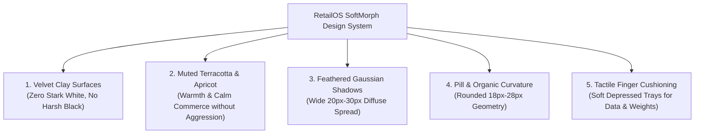

# RetailOS SoftMorph Design System
## Ultra-Soft Tactile Neomorphism & Warm Terracotta / Apricot Psychology
### Engineered for Calm Focus, Zero Eye-Strain, and Tactile Touch Counters

---

## Document Control & Governance

- **System Name:** **RetailOS SoftMorph Design System**
- **Document Identifier:** DS-SOFTMORPH-2026-V3.0
- **Version:** 3.0 (Ultra-Soft Tactile & Warm Terracotta / Muted Apricot)
- **Target Runtimes:** Desktop (Tauri v2: Windows, macOS, Linux), Mobile (Tauri v2 Mobile: Android, iOS), Web (Dioxus WASM)
- **Design Philosophy:** Organic Clay & Velvet Shadows + Muted Apricot/Terracotta Orange Psychology + Ultra-Soft Ergonomics (Zero harsh borders, zero stark glare)
- **Derived From:**
  - Prototype & Design System v2.0 (`docs/ui-ux-design-system.md`, `docs/prototype-aeroglass-retailos.html`)
  - BRD Specifications (`docs/brd-retail-store-erp.md`)

---

## 1. Design Psychology: Why Ultra-Soft Velvet Clay & Terracotta?



### 1.1 The Psychological Science of "Softness" in Busy Retail
- **The Fatigue of High-Contrast Systems:** Cashiers and solo shopkeepers spend 8 to 12 hours staring at billing screens under harsh fluorescent store lights. Harsh drop shadows, sharp edges, and intense electric oranges create visual fatigue and headaches.
- **The "Warm Terracotta / Apricot" Principle:**
  - Instead of aggressive neon orange (`#FF6B00`), we use **Warm Terracotta (`#E06D3B`)**, **Velvet Apricot (`#F39159`)**, and **Golden Honey (`#E5A344`)**.
  - Terracotta is earthy, organic, grounded, and welcoming. It carries the energy and urgency of orange, but is balanced with earthy warmth—making the app feel like a crafted, tactile physical cash register rather than a cold computer terminal.
- **The "Velvet Clay" Principle:**
  - **Light Mode (`#F0EBE3` Warm Oatmeal / Rice Paper):** A soothing, matte, organic cream. No blinding `#FFFFFF` glare.
  - **Dark Mode (`#1B1C20` Smoked Basalt / Charcoal Velvet):** A deep, warm grey with indigo-amber undertones. No pitch-black `#000000` void that causes optical ghosting.

---

## 2. Color Palette & Harmonic Semantic Tokens

### 2.1 Color Palette Table

| Semantic Role | Light Mode (Warm Oatmeal Clay) | Dark Mode (Smoked Basalt) | Psychology & Cognitive Purpose |
|:---|:---|:---|:---|
| **Base Canvas** | `#F0EBE3` (Oatmeal Cream) | `#1B1C20` (Smoked Basalt) | Neutral ambient background; calm and glare-free |
| **Surface Highlight** | `#FFFFFF` (Soft Diffuse Light) | `#26282E` (Gentle Ambient Rim) | Soft top-left ambient bounce |
| **Surface Shadow** | `rgba(180, 168, 154, 0.40)` | `rgba(13, 14, 16, 0.65)` | Extra-wide diffuse feathered occlusion |
| **Primary Accent (Terracotta)** | `#E06D3B` (Earthy Terracotta) | `#F07A48` (Warm Apricot Sunset) | Primary tender button, key checkout triggers |
| **Secondary Accent (Honey Amber)**| `#E5A344` (Golden Honey) | `#F2B35B` (Warm Glow Amber) | Badges, variant tags, customer credit pill |
| **Soft Sage Success** | `#4E9C68` (Muted Sage Green) | `#5BB97A` (Soft Mint Leaf) | Completed payments, positive cash balance |
| **Soft Coral Danger** | `#D9534F` (Earthy Coral Rust) | `#E56763` (Soft Rust Red) | Line voids, discrepancy alert |
| **Text Primary** | `#2C2B29` (Deep Espresso Charcoal)| `#EAE7E2` (Soft Cashmere White) | High legibility without harsh eye strain |
| **Text Secondary** | `#757069` (Warm Clay Grey) | `#9E988F` (Muted Sand Grey) | Units (kg/pcs), timestamps, sub-labels |
| **Text Muted** | `#A8A298` | `#63615C` | Inactive icons, subtle keyboard hotkey hints |

---

## 3. Ultra-Soft Shadow Engine: The Math of Feathered Soft-UI

Unlike early neomorphism which used tight, muddy shadows, **Ultra-Soft SoftMorph** uses wide radius spreads with soft alpha channels for a pillowy, tactile look:

```css
/* ========================================================
   LIGHT MODE: WARM OATMEAL CLAY (#F0EBE3)
   ======================================================== */
:root {
  --soft-bg: #F0EBE3;

  /* Level 1: Soft Raised Cushion (Product Tiles, Cards) */
  --soft-raised-card: 
    -8px -8px 22px rgba(255, 255, 255, 0.95),
     8px  8px 22px rgba(185, 173, 158, 0.38);

  /* Level 2: Soft Floating Cushion (Floating Bar, Modals) */
  --soft-floating: 
    -12px -12px 32px rgba(255, 255, 255, 1.0),
     14px  14px 34px rgba(175, 162, 146, 0.45);

  /* Level 3: Soft Carved Inset Tray (Search, Scale, Cart Items) */
  --soft-inset-tray: 
    inset  5px  5px 12px rgba(185, 173, 158, 0.45),
    inset -5px -5px 12px rgba(255, 255, 255, 0.95);

  /* Primary Terracotta Soft Button */
  --btn-terracotta-grad: 
    linear-gradient(145deg, #E87543, #D46231);
  --btn-terracotta-shadow: 
    -5px -5px 14px rgba(255, 255, 255, 0.90),
     7px  7px 20px rgba(212, 98, 49, 0.35);
}

/* ========================================================
   DARK MODE: SMOKED BASALT CLAY (#1B1C20)
   ======================================================== */
[data-theme="dark"] {
  --soft-bg: #1B1C20;

  /* Level 1: Soft Raised Cushion */
  --soft-raised-card: 
    -6px -6px 20px rgba(42, 45, 52, 0.40),
     7px  7px 22px rgba(13, 14, 16, 0.75);

  /* Level 2: Soft Floating Cushion */
  --soft-floating: 
    -10px -10px 28px rgba(45, 48, 56, 0.50),
     12px  12px 32px rgba(10, 11, 13, 0.90);

  /* Level 3: Soft Carved Inset Tray */
  --soft-inset-tray: 
    inset  5px  5px 12px rgba(11, 12, 14, 0.85),
    inset -5px -5px 12px rgba(42, 45, 52, 0.30);

  /* Primary Terracotta Soft Button */
  --btn-terracotta-grad: 
    linear-gradient(145deg, #F58352, #E06D3B);
  --btn-terracotta-shadow: 
    -4px -4px 14px rgba(45, 48, 56, 0.35),
     7px  7px 22px rgba(224, 109, 59, 0.38);
}
```

---

## 4. Tactile Component Anatomy

### 4.1 Pill-Shaped Organic Touch Controls
- **Radii Standards:** Rounded surfaces (`18px` to `24px` for cards, `30px` for pills and action buttons). Sharp $90^\circ$ corners are completely eliminated to create a calm, approachable feel.
- **Feathered Tap Feedback:** When touched, an extruded card cushions downward by `1.5px` and its shadow gently softens into an inset indentation, replicating memory foam or a physical mechanical silicone key.

### 4.2 Seamless Embedded Trays
- The **Active Cart**, **Barcode Search Bar**, and **Live Scale Indicator** are not stark floating rectangles; they are **feather-carved trays** molded into the store counter surface.

---

## 5. Dioxus Rust & Tailwind Implementation

```rust
use dioxus::prelude::*;

#[derive(Clone, Copy, PartialEq, Default)]
pub enum SoftStyle {
    #[default]
    CushionCard,
    CarvedTray,
    TerracottaAction,
}

#[derive(Props, Clone, PartialEq)]
pub struct SoftTileProps {
    children: Element,
    #[props(default = "")]
    class: &'static str,
    #[props(default)]
    style: SoftStyle,
    #[props(default)]
    onclick: Option<EventHandler<MouseEvent>>,
}

#[component]
pub fn SoftTile(props: SoftTileProps) -> Element {
    let style_classes = match props.style {
        SoftStyle::CushionCard => "bg-soft-bg shadow-soft-raised-card hover:translate-y-[-1px] active:translate-y-[1px] active:shadow-soft-inset-tray text-neutral-800 dark:text-neutral-100",
        SoftStyle::CarvedTray => "bg-soft-bg shadow-soft-inset-tray text-neutral-700 dark:text-neutral-200",
        SoftStyle::TerracottaAction => "bg-gradient-to-r from-orange-600 to-amber-600 text-white shadow-soft-terracotta active:scale-[0.98]",
    };

    rsx! {
        div {
            class: "rounded-2xl transition-all duration-200 select-none p-4 {style_classes} {props.class}",
            onclick: move |evt| {
                if let Some(handler) = &props.onclick {
                    handler.call(evt);
                }
            },
            {props.children}
        }
    }
}
```
