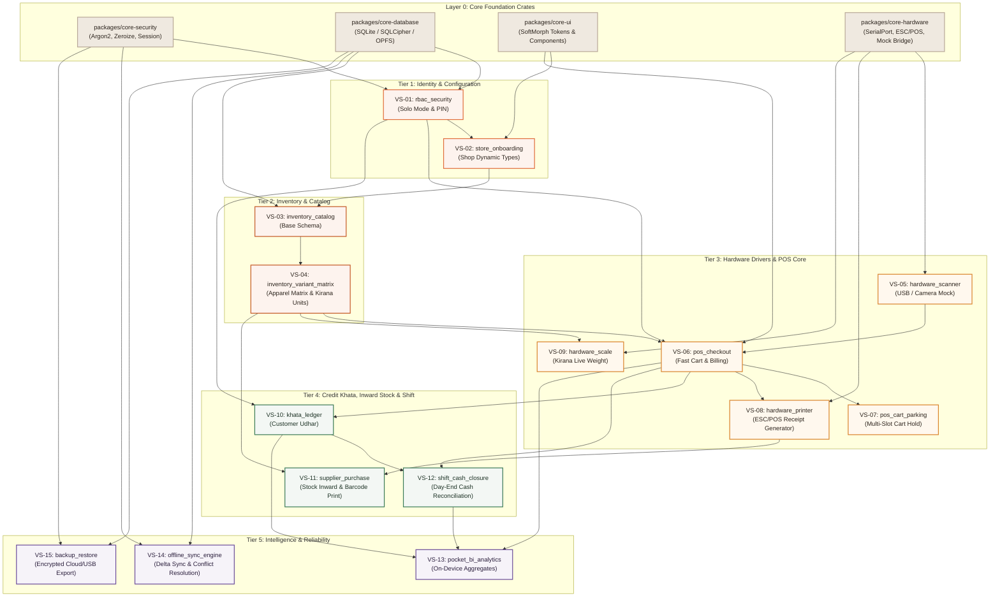

# Vertical Slices Index Map & Dependency Graph
**Document Version:** 1.0  
**Project:** RetailOS / Store ERP (Dioxus 0.7 + Tauri v2.12 + SQLCipher)  
**Architecture:** Strict Vertical Slice Architecture (VSA)  
**Date:** October 2026  
**Status:** Canonical Implementation Index  

---

## 1. Architectural Philosophy & Slice Independence

In RetailOS, each feature is modeled as an **autonomous, vertically integrated slice** spanning the full stack:
- **`SLICE.md`**: Token-efficient feature manifest (< 250 tokens) for AI agent reasoning.
- **`internal/`**: Private domain models, state machines, and repository queries (hidden behind Rust visibility boundaries).
- **`external/`**: Public interface (`views/`, `components/`, `hooks/`, and isolated `style.css`).
- **`test/`**: In-slice continuous verification (`test/fr/` functional tests + `test/nfr/` non-functional benchmarks & security fuzzers).

### Fundamental Coupling Rules
1. **Vertical Isolation**: Slices **never import private internals** of another slice. Cross-slice interaction occurs strictly via:
   - Shared platform foundations (`packages/core-*`)
   - Explicit domain events (`DomainEvent::ItemScanned`, `DomainEvent::CheckoutCompleted`)
   - Pure ID foreign keys or public slice query traits.
2. **Layer Zero Foundations**: Only shared infrastructure (`core-database`, `core-security`, `core-hardware`, `core-ui`) can be imported universally.
3. **Directed Acyclic Graph (DAG)**: Slice dependencies must form a strict DAG. Cyclic dependencies between slices are strictly forbidden by `cargo-deny` and compiler checks.

---

## 2. Complete Vertical Slice Master Index

| Slice ID | Slice Identifier (`src/features/`) | Module Mapping | Primary Capability | Core Dependencies | Phase / Sprint |
| :--- | :--- | :--- | :--- | :--- | :--- |
| **VS-01** | `rbac_security` | Module 1: Auth & Store | Solo Mode & Master PIN Gate | `core-security`, `core-database` | Phase 1 (Sprint 1) |
| **VS-02** | `store_onboarding` | Module 1: Auth & Store | Store Type Setup (Clothes/Shoes/Kirana) | `VS-01`, `core-database`, `core-ui` | Phase 1 (Sprint 1) |
| **VS-03** | `inventory_catalog` | Module 2: Catalog & Stock | Base Product Schema & Categories | `VS-02`, `core-database`, `core-ui` | Phase 1 (Sprint 2) |
| **VS-04** | `inventory_variant_matrix` | Module 2: Catalog & Stock | Apparel Size/Color Matrix & Kirana Units | `VS-03`, `core-database` | Phase 1 (Sprint 2) |
| **VS-05** | `hardware_scanner` | Module 5: Hardware Bridge | Barcode Scanner & Virtual Mock Bridge | `core-hardware`, `core-database` | Phase 1 (Sprint 3) |
| **VS-06** | `pos_checkout` | Module 3: Checkout & Billing | Fast Scanning, Cart & Multi-Tender | `VS-01`, `VS-04`, `VS-05`, `core-ui` | Phase 1 (Sprint 3) |
| **VS-07** | `pos_cart_parking` | Module 3: Checkout & Billing | 3-Slot Cart Suspension & Recall | `VS-06`, `core-database` | Phase 1 (Sprint 4) |
| **VS-08** | `hardware_printer` | Module 5: Hardware Bridge | ESC/POS Thermal Printing & Drawers | `core-hardware`, `VS-06` | Phase 1 (Sprint 4) |
| **VS-09** | `hardware_scale` | Module 5: Hardware Bridge | Kirana Serial Weighing Scale Parsing | `core-hardware`, `VS-04` | Phase 2 (Sprint 5) |
| **VS-10** | `khata_ledger` | Module 4: Ledger & Accounts | Customer Udhar, Credit Limits & WhatsApp | `VS-01`, `VS-06`, `core-database` | Phase 2 (Sprint 5) |
| **VS-11** | `supplier_purchase` | Module 2: Catalog & Stock | Stock Intake, Grayscale Barcodes & POs | `VS-04`, `VS-08`, `core-database` | Phase 2 (Sprint 6) |
| **VS-12** | `shift_cash_closure` | Module 3: Checkout & Billing | Daily Day-End Cash Balancing & P&L | `VS-01`, `VS-06`, `VS-10` | Phase 2 (Sprint 6) |
| **VS-13** | `pocket_bi_analytics` | Module 4: Ledger & Accounts | Fast On-Device Profit & Dead Stock Metrics | `VS-04`, `VS-06`, `VS-10`, `VS-12` | Phase 3 (Sprint 7) |
| **VS-14** | `offline_sync_engine` | Module 5: Hardware Bridge | SQLite CRDT / Delta Merging across devices | `core-database`, `core-security` | Phase 3 (Sprint 7) |
| **VS-15** | `backup_restore` | Module 1: Auth & Store | Encrypted SQLCipher DB Export/Import | `core-database`, `core-security` | Phase 3 (Sprint 8) |

---

## 3. Visual Dependency Graph (DAG)



---

## 4. Slice Technical Manifests & Contract Registry

Each vertical slice enforces a standardized directory structure and manifest.

### 4.1 Canonical Slice Structure
```
src/features/<slice_name>/
├── SLICE.md                     # Token-efficient AI manifest (< 250 tokens)
├── mod.rs                       # Slice public gateway (re-exports external only)
├── internal/                    # Private implementation
│   ├── logic.rs                 # Domain invariants & pure state machines
│   ├── models.rs                # SQLite entities & private DTOs
│   └── repo.rs                  # Direct SQLite / SQLCipher queries
├── external/                    # Public consumption interface
│   ├── style.css                # Slice-scoped SoftMorph CSS (zero Rust rebuild)
│   ├── components/              # Dioxus 0.7 RSX sub-components
│   ├── hooks/                   # Reactive state signals & queries
│   └── views.rs                 # Primary view route mountable by router
└── test/                        # Continuous In-Slice Verification
    ├── fr/                      # Functional Requirements
    │   ├── unit_*.rs            # Pure logic & edge-case unit tests
    │   ├── integ_*.rs           # SQLite repository round-trip tests
    │   ├── rbac_*.rs            # Solo Mode vs Cashier privilege tests
    │   └── e2e_*.rs             # Headless Virtual DOM / browser flow
    └── nfr/                     # Non-Functional Requirements
        ├── perf_*.rs            # Criterion micro-benchmarks (< 50ms / < 5ms)
        └── sec_*.rs             # Input fuzzing & parameter sanitization
```

### 4.2 Detailed Slice Contracts

#### [VS-01] `rbac_security`
- **Purpose**: Controls Solo Mode bypass, Cashier/Manager role separation, and Master PIN security.
- **Upstream Dependencies**: `packages/core-security`, `packages/core-database`.
- **Downstream Consumers**: `VS-02`, `VS-06`, `VS-10`, `VS-12`.
- **Exported Types / Signals**: `Role`, `SessionToken`, `use_rbac_auth()`, `MasterPinModal`.
- **Test Gate**: Unit PIN hashing, SQL injection fuzz, Solo Mode toggle benchmark (< 0.1ms).

#### [VS-02] `store_onboarding`
- **Purpose**: First-run wizard setting store category (`Clothes`, `Footwear`, `Kirana`, `Custom`) and tax structure.
- **Upstream Dependencies**: `VS-01`, `packages/core-database`, `packages/core-ui`.
- **Downstream Consumers**: `VS-03`, `VS-04`.
- **Exported Types / Signals**: `StoreProfile`, `StoreCategory`, `use_store_profile()`.

#### [VS-03] `inventory_catalog`
- **Purpose**: Base catalog management, category tree, barcode indexing, and tax brackets.
- **Upstream Dependencies**: `VS-02`, `packages/core-database`, `packages/core-ui`.
- **Downstream Consumers**: `VS-04`, `VS-06`, `VS-11`.
- **Exported Types / Signals**: `Product`, `Category`, `ProductQueryTrait`, `use_catalog()`.

#### [VS-04] `inventory_variant_matrix`
- **Purpose**: Dynamic matrix handling 2D Apparel matrices (Size × Color) and Kirana fractional units (kg, g, L).
- **Upstream Dependencies**: `VS-03`, `packages/core-database`.
- **Downstream Consumers**: `VS-06`, `VS-09`, `VS-11`, `VS-13`.
- **Exported Types / Signals**: `VariantMatrix`, `MeasurementUnit`, `StockLevel`, `use_variant_matrix()`.

#### [VS-05] `hardware_scanner`
- **Purpose**: Low-latency barcode/QR input via USB HID, serial COM port, or Web Camera mock.
- **Upstream Dependencies**: `packages/core-hardware`, `packages/core-database`.
- **Downstream Consumers**: `VS-06`.
- **Exported Types / Signals**: `BarcodeEvent`, `use_scanner_stream()`, `MockScannerFeed`.

#### [VS-06] `pos_checkout`
- **Purpose**: High-speed counter sales checkout, item calculation, split tender (Cash, UPI, Khata).
- **Upstream Dependencies**: `VS-01`, `VS-04`, `VS-05`, `packages/core-ui`.
- **Downstream Consumers**: `VS-07`, `VS-08`, `VS-10`, `VS-12`, `VS-13`.
- **Exported Types / Signals**: `Invoice`, `CartItem`, `PaymentTender`, `use_pos_cart()`, `PosCheckoutView`.

#### [VS-07] `pos_cart_parking`
- **Purpose**: Holds up to 3 active customer carts in local SQLite to serve secondary customers without losing state.
- **Upstream Dependencies**: `VS-06`, `packages/core-database`.
- **Downstream Consumers**: None (Leaf UI optimization).
- **Exported Types / Signals**: `ParkedCart`, `park_cart_command()`, `recall_cart_command()`.

#### [VS-08] `hardware_printer`
- **Purpose**: Native ESC/POS thermal receipt generation (58mm / 80mm) and cash drawer kick.
- **Upstream Dependencies**: `packages/core-hardware`, `VS-06`.
- **Downstream Consumers**: `VS-11`.
- **Exported Types / Signals**: `ReceiptPayload`, `print_receipt_job()`, `test_drawer_kick()`.

#### [VS-09] `hardware_scale`
- **Purpose**: Reads continuous RS-232 serial streams from Kirana digital weighing scales to populate POS quantities.
- **Upstream Dependencies**: `packages/core-hardware`, `VS-04`.
- **Downstream Consumers**: `VS-06`.
- **Exported Types / Signals**: `ScaleWeight`, `use_live_scale()`.

#### [VS-10] `khata_ledger`
- **Purpose**: Customer credit accounting (Udhar), customer ledger balance, WhatsApp payment reminder generation.
- **Upstream Dependencies**: `VS-01`, `VS-06`, `packages/core-database`.
- **Downstream Consumers**: `VS-12`, `VS-13`.
- **Exported Types / Signals**: `KhataAccount`, `KhataTransaction`, `use_khata_customer()`, `KhataLedgerView`.

#### [VS-11] `supplier_purchase`
- **Purpose**: Supplier inward stock intake, wholesale bills, and batch barcode label generation.
- **Upstream Dependencies**: `VS-04`, `VS-08`, `packages/core-database`.
- **Downstream Consumers**: `VS-13`.
- **Exported Types / Signals**: `PurchaseOrder`, `InwardBatch`, `record_inward_stock()`.

#### [VS-12] `shift_cash_closure`
- **Purpose**: Solo/duo operator daily shift closure, expected vs physical cash counting, and Z-report printing.
- **Upstream Dependencies**: `VS-01`, `VS-06`, `VS-10`.
- **Downstream Consumers**: `VS-13`.
- **Exported Types / Signals**: `ShiftRecord`, `CashDenomination`, `use_shift_reconciliation()`.

#### [VS-13] `pocket_bi_analytics`
- **Purpose**: Fast on-device analytics: daily gross margins, top apparel sizes, dead stock alerts, and Kirana velocity.
- **Upstream Dependencies**: `VS-04`, `VS-06`, `VS-10`, `VS-12`.
- **Downstream Consumers**: None (Reporting leaf).
- **Exported Types / Signals**: `DailyKpiReport`, `DeadStockItem`, `use_pocket_bi()`, `PocketBiView`.

#### [VS-14] `offline_sync_engine`
- **Purpose**: P2P delta sync and central cloud synchronization using conflict-free timestamp ordering.
- **Upstream Dependencies**: `packages/core-database`, `packages/core-security`.
- **Downstream Consumers**: None (Background engine).
- **Exported Types / Signals**: `SyncStatus`, `DeltaPacket`, `trigger_manual_sync()`.

#### [VS-15] `backup_restore`
- **Purpose**: One-click encrypted snapshot of SQLite database to USB pendrive or local download.
- **Upstream Dependencies**: `packages/core-database`, `packages/core-security`.
- **Downstream Consumers**: None (Utility leaf).
- **Exported Types / Signals**: `BackupSnapshot`, `create_db_backup()`, `restore_db_backup()`.

---

## 5. Token Efficiency & Agent Navigation Map

When an AI agent or developer is assigned to work on a capability, they consult this map to locate the exact slice and only load the files needed:

```
Task: "Add size 44 shoe variant to Footwear catalog"
└── Jump to: src/features/inventory_variant_matrix/
    ├── Read: SLICE.md (180 tokens - understands schema & models)
    ├── Edit: internal/logic.rs (domain rules)
    ├── Run:  cargo nextest run --package feature-inventory-variant-matrix

Task: "Adjust button soft-shadow depth on Cart Parking"
└── Jump to: src/features/pos_cart_parking/
    ├── Read: SLICE.md (120 tokens)
    ├── Edit: external/style.css (zero Rust rebuild, zero logic touched)
    ├── Hot-reload in Dioxus Web UI
```

---
*This index map enforces strict boundaries, zero circular references, continuous in-slice testability, and token-optimized AI agent context navigation.*
